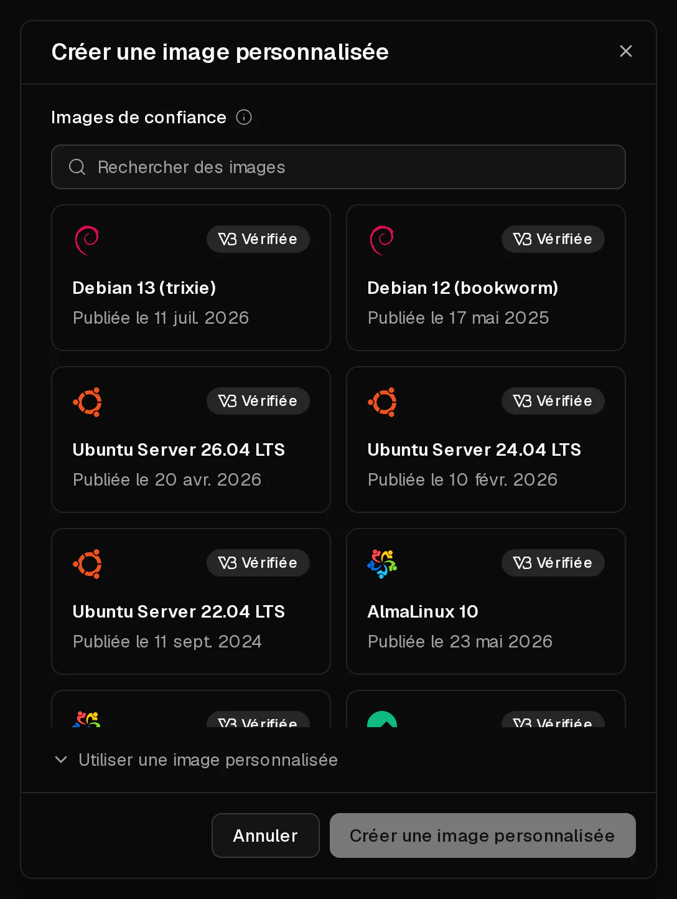
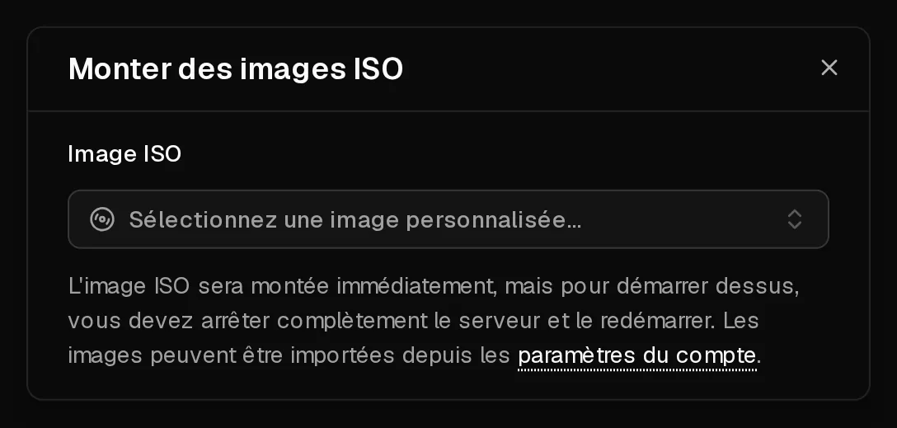

Si le système que vous voulez ne figure pas dans notre liste, vous pouvez l'installer depuis une <Term id="iso-image">image ISO</Term>, comme sur une machine physique : insérer le disque, démarrer dessus, lancer l'installateur. Vous pouvez aussi démarrer un système live de cette façon pour dépanner un serveur qui ne démarre plus.

L'installation depuis une ISO s'adresse aux utilisateurs expérimentés. Contrairement à nos systèmes prêts à l'emploi, rien n'est configuré pour vous : vous configurez vous-même le réseau, et le portail ne peut réinitialiser les mots de passe ou lire le système que si vous installez l'<Term id="guest-agent">agent invité QEMU</Term>.

## Avant de commencer

- **Sauvegardez** tout ce que vous voulez conserver. L'installation d'un nouveau système efface généralement le disque.
- **Notez vos paramètres réseau.** Votre serveur utilise des adresses statiques, et il n'y a pas de DHCP. Sur la page <Ui>Aperçu</Ui>, copiez l'adresse <Ui>IPv4</Ui> et sa passerelle (<Ui>Gateway</Ui>), et faites de même pour l'<Ui>IPv6</Ui>.
- **Prévoyez 60 minutes.** Une image ISO reste disponible 60 minutes après son ajout. Ensuite, elle est démontée et supprimée automatiquement.

## 1. Ajouter l'image ISO

1. Ouvrez [Compte > Images ISO](https://app.virtbase.com/account/settings/custom-images) et cliquez sur <Ui>Créer une image personnalisée</Ui>.
2. Choisissez une image dans <Ui>Images de confiance</Ui>, comme Debian, Ubuntu, AlmaLinux, Rocky Linux, Fedora, Alpine, Arch Linux, NixOS, FreeBSD ou les pilotes VirtIO pour Windows. Les images marquées <Ui>Vérifiée</Ui> sont contrôlées à l'aide de la somme de contrôle de l'éditeur.
3. Ou bien sélectionnez <Ui>Utiliser une image personnalisée</Ui> et saisissez un <Ui>Nom</Ui> et l'<Ui>URL</Ui> du fichier ISO.
4. Cliquez sur <Ui>Créer une image personnalisée</Ui>.



L'image est téléchargée sur notre stockage. La liste affiche la progression sous la forme <Ui>Envoi en cours</Ui> avec un pourcentage, ainsi que <Ui>Expire</Ui> avec l'heure à laquelle elle sera supprimée.

Une URL personnalisée doit :

- commencer par `https://` et utiliser un nom de domaine, et non une adresse IP,
- pointer directement vers un fichier se terminant par `.iso`, sans identification,
- indiquer la taille du fichier, qui ne peut pas dépasser 10 Go.

Vous pouvez avoir jusqu'à **3** images ISO à la fois, et en ajouter jusqu'à 10 par heure.

## 2. Monter l'ISO et démarrer dessus

1. Ouvrez votre serveur. Dans la rangée de boutons d'alimentation, ouvrez le menu et sélectionnez <Ui>Monter l'ISO</Ui>.
2. Sous <Ui>Image ISO</Ui>, choisissez votre image. Elle est montée immédiatement.
3. **Éteignez le serveur, puis rallumez-le.** Un redémarrage depuis l'intérieur du serveur ne suffit pas : le serveur ne démarre sur l'ISO qu'après un arrêt complet suivi d'un démarrage. Cliquez sur <Ui>Éteindre</Ui>, attendez que le serveur soit <Ui>Hors ligne</Ui>, puis cliquez sur <Ui>Démarrer</Ui>.
4. Ouvrez l'onglet <Ui>Console</Ui>. Vous voyez l'installateur ou le système live.



## 3. Installer le système et configurer le réseau

Lancez l'installateur dans la [console](/fr/help/article/how-to-use-console). Lorsqu'il vous demande la configuration réseau, choisissez la configuration manuelle et saisissez :

| Paramètre | Valeur |
| --- | --- |
| <Term id="ipv4">Adresse IPv4</Term> | L'adresse de la page <Ui>Aperçu</Ui>, avec le préfixe `/32` |
| <Term id="gateway">Passerelle</Term> IPv4 | La passerelle (<Ui>Gateway</Ui>) de la page <Ui>Aperçu</Ui> |
| Serveurs DNS | `9.9.9.9` et `149.112.112.112`, ou les vôtres |
| Adresse IPv6 | Une adresse de votre /64, avec le préfixe `/64` |
| Passerelle IPv6 | La passerelle (<Ui>Gateway</Ui>) IPv6 de la page <Ui>Aperçu</Ui> |

Comme l'adresse est en `/32`, la passerelle n'est pas dans le même sous-réseau. Beaucoup d'installateurs gèrent ce cas ; si le vôtre ne le fait pas, ajoutez d'abord une route vers la passerelle. Avec netplan, par exemple :

```yaml title="/etc/netplan/01-network.yaml"
network:
  version: 2
  ethernets:
    eth0:
      addresses: [203.0.113.10/32]
      routes:
        - to: 203.0.113.1/32
          scope: link
        - to: 0.0.0.0/0
          via: 203.0.113.1
          on-link: true
      nameservers:
        addresses: [9.9.9.9, 149.112.112.112]
```

## 4. Démonter l'ISO

Une fois l'installation terminée, ouvrez à nouveau <Ui>Monter l'ISO</Ui> et cliquez sur le bouton de démontage à côté de l'image. Éteignez le serveur, puis rallumez-le, pour qu'il démarre sur son disque.

Installez ensuite l'agent invité QEMU, par exemple avec `apt install qemu-guest-agent`. Sans lui, le portail ne peut pas [réinitialiser les mots de passe](/fr/help/article/how-to-reset-root-password), afficher l'utilisation du disque ni proposer de recommandations de pare-feu.

## Installer Windows

Windows est autorisé sur les serveurs Virtbase. Nous ne fournissons ni images ni licences Windows : vous l'installez depuis votre propre ISO et utilisez votre propre licence.

1. Dans l'onglet <Ui>Avancé</Ui>, réglez le BIOS sur <Ui>UEFI</Ui> et le <Term id="tpm">TPM</Term> sur <Ui>v2.0</Ui>. Windows 11 ne s'installe pas sans cela.
2. Ajoutez votre ISO Windows ainsi que les **pilotes VirtIO** depuis <Ui>Images de confiance</Ui>.
3. Montez l'ISO Windows et lancez l'installateur comme décrit ci-dessus.
4. Lorsque l'installateur ne trouve aucun disque, montez à la place l'ISO des pilotes VirtIO. Elle remplace l'ISO Windows dans le lecteur virtuel. Dans l'installateur, sélectionnez <Ui>Charger un pilote</Ui> et choisissez le pilote de stockage sur le disque des pilotes.
5. Montez à nouveau l'ISO Windows et poursuivez l'installation.
6. Après l'installation, installez les autres pilotes VirtIO et l'agent invité depuis l'ISO des pilotes, puis configurez le réseau comme indiqué dans le tableau ci-dessus.

## Dépanner un serveur qui ne démarre pas

Pour réparer un système endommagé, montez un système live, comme l'installateur Debian ou Ubuntu, démarrez dessus et montez votre disque depuis celui-ci. Démontez l'ISO lorsque vous avez terminé. Si vous n'êtes pas sûr de la marche à suivre, [contactez le support](/fr/contact) avant de modifier quoi que ce soit.

## Si cela n'a pas fonctionné

- **L'image ISO n'est pas ajoutée** : vérifiez que l'URL commence par `https://`, se termine par `.iso`, ne demande pas d'identification et que le fichier ne dépasse pas 10 Go.
- <Msg>Vous pouvez avoir jusqu'à 3 images ISO actives.</Msg> Attendez que l'une d'elles expire ; les images sont supprimées 60 minutes après leur ajout.
- **Le serveur démarre sur l'ancien système** : vous avez redémarré au lieu d'éteindre puis de rallumer le serveur. Éteignez-le complètement, puis démarrez-le.
- **Pas de réseau après l'installation** : vérifiez le préfixe de l'adresse (`/32`), la route vers la passerelle et les serveurs DNS. Consultez [Impossible de se connecter à mon serveur](/fr/help/article/cant-connect-to-server).
- <Msg>Impossible de monter l'image ISO.</Msg> L'image est encore en cours de téléchargement ou a expiré, ou le serveur est en cours d'installation, suspendu ou restreint par un dossier d'abus.
