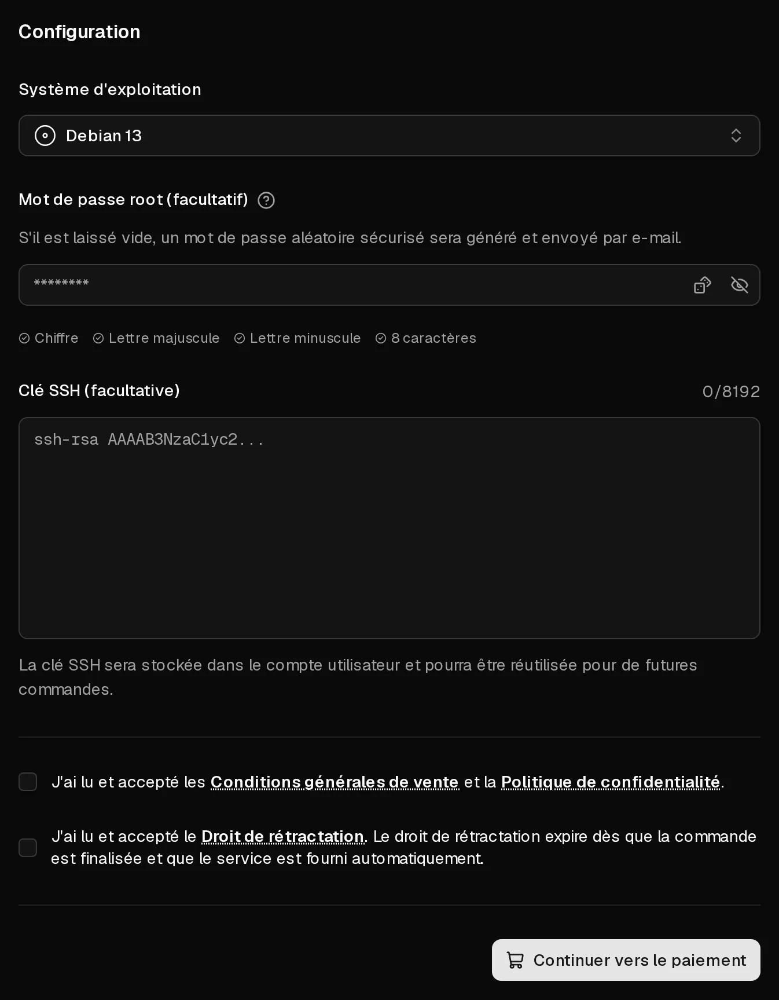

Commander ne prend que quelques minutes : vous choisissez un forfait, sélectionnez le système d'exploitation, puis payez. Virtbase installe ensuite le serveur automatiquement et vous envoie un e-mail dès que vous pouvez vous connecter. Vous avez besoin d'un compte Virtbase, que vous pouvez créer pendant la commande.

Chaque forfait comprend une <Term id="ipv4">adresse IPv4</Term>, un <Term id="ipv6-subnet">sous-réseau IPv6 /64</Term> et un trafic illimité dans le cadre d'une politique d'<Term id="fair-use">utilisation raisonnable</Term> (fair use). Les prix sont mensuels et incluent la TVA légale lorsqu'elle s'applique.

## Passer la commande

1. Sur la [page d'accueil de Virtbase](/fr), choisissez un forfait et cliquez sur <Ui>Configurer maintenant</Ui>. Si un forfait affiche <Ui>Épuisé</Ui>, il ne peut pas être commandé pour le moment.
2. Connectez-vous, ou cliquez sur <Ui>S'inscrire</Ui> pour créer un compte.
3. Sous <Ui>Système d'exploitation</Ui>, choisissez le système à installer.
4. Facultatif : sous <Ui>Clé SSH (facultative)</Ui>, choisissez une clé existante ou cliquez sur <Ui>Ajouter une nouvelle clé SSH</Ui> et collez votre clé publique. Vous pourrez alors vous connecter sans mot de passe.
5. Facultatif : sous <Ui>Mot de passe root (facultatif)</Ui>, définissez un mot de passe pour `root`. Si vous laissez ce champ vide, un mot de passe aléatoire sécurisé est généré et vous est envoyé par e-mail.
6. Acceptez les Conditions générales de vente, la Politique de confidentialité et le Droit de rétractation.
7. Cliquez sur <Ui>Continuer vers le paiement</Ui>.

<Hint>
Virtbase ne stocke pas votre mot de passe root. Notez-le, ou utilisez une <Term id="ssh-key">clé SSH</Term>. Vous pouvez [réinitialiser le mot de passe](/fr/help/article/how-to-reset-root-password) à tout moment dans le portail client.
</Hint>

## Payer

1. Renseignez votre <Ui>Adresse de facturation</Ui>. Elle sert pour la facture et pour le calcul de la TVA.
2. Choisissez un <Ui>Mode de paiement</Ui> : carte, <Term id="sepa-mandate">prélèvement SEPA</Term> ou PayPal. Pour les commandes de 5,00 € ou plus, vous pouvez aussi sélectionner <Ui>Payer anonymement en cryptomonnaie</Ui>.
3. Cliquez sur <Ui>Payer maintenant</Ui> et effectuez la confirmation éventuellement demandée par votre banque.

Les paiements par carte et par PayPal sont confirmés en quelques secondes. Avec le prélèvement SEPA et la cryptomonnaie, vous voyez <Ui>Le paiement est en cours de traitement</Ui> : la commande n'est exécutée qu'une fois le paiement arrivé, ce qui peut prendre plus de temps.

En finalisant la commande, vous acceptez que le serveur soit mis à disposition immédiatement. Votre droit de rétractation expire donc dès que le serveur a été mis en place, comme décrit dans le Droit de rétractation.

## Après le paiement

Votre serveur apparaît dans la [liste des serveurs](https://app.virtbase.com/servers) avec le statut <Ui>Installation...</Ui>. L'installation se fait automatiquement et prend généralement quelques minutes.

Une fois l'installation terminée, vous recevez l'e-mail <Msg>Votre serveur est prêt</Msg> avec le nom d'utilisateur et, si vous n'en avez pas défini, le mot de passe root généré. Pour des raisons de sécurité, l'e-mail ne contient pas l'adresse IP. Cliquez sur <Ui>Copier l'adresse IP</Ui> dans la liste des serveurs pour la copier.

Étape suivante : [vous connecter à votre serveur pour la première fois](/fr/help/article/how-to-connect-to-server).

Votre serveur fonctionne pendant un mois. Pour qu'il continue de fonctionner, [renouvelez-le](/fr/help/article/how-to-renew-server) ou [activez le renouvellement automatique](/fr/help/article/how-to-set-up-automatic-renewal). Votre facture est disponible dans [Factures](https://app.virtbase.com/invoices) et vous est envoyée par e-mail.

## En cas de problème

### La page de paiement signale un problème

- <Ui>La commande nécessite une action</Ui> ou <Ui>La commande nécessite une confirmation</Ui> : votre banque veut que vous confirmiez le paiement, par exemple dans votre application bancaire. Confirmez-le et revenez sur la page.
- <Ui>Le paiement n'a pas pu être effectué</Ui> : le paiement a été refusé. Vérifiez vos informations, ou essayez un autre mode de paiement.
- <Ui>Commande annulée</Ui> : rien n'a été prélevé. Passez une nouvelle commande.

### J'ai payé, mais je n'ai pas de serveur

- Avec le prélèvement SEPA ou la cryptomonnaie, le serveur n'est mis en place qu'une fois le paiement arrivé.
- Consultez la [liste des serveurs](https://app.virtbase.com/servers). Un serveur avec le statut <Ui>Installation...</Ui> est en cours de mise en place ; l'e-mail suit une fois l'installation terminée.
- Cherchez l'e-mail <Msg>Votre serveur est prêt</Msg> dans votre dossier de courrier indésirable.

Si rien de tout cela ne s'applique au bout d'une heure, [contactez le support](/fr/contact) en indiquant votre identifiant de compte, que vous trouvez sous <Ui>Votre identifiant</Ui> dans les [paramètres de votre compte](https://app.virtbase.com/account/settings).

### Les nouvelles commandes sont suspendues

Si vous voyez <Msg>Les nouvelles commandes sont suspendues tant qu'un dossier d'abus est ouvert.</Msg>, c'est qu'un signalement d'abus concernant l'un de vos serveurs est toujours ouvert. Répondez-y dans [Signalements d'abus](https://app.virtbase.com/abuse) ; consultez [Que faire si je reçois un signalement d'abus ?](/fr/help/article/about-abuse-reports)
