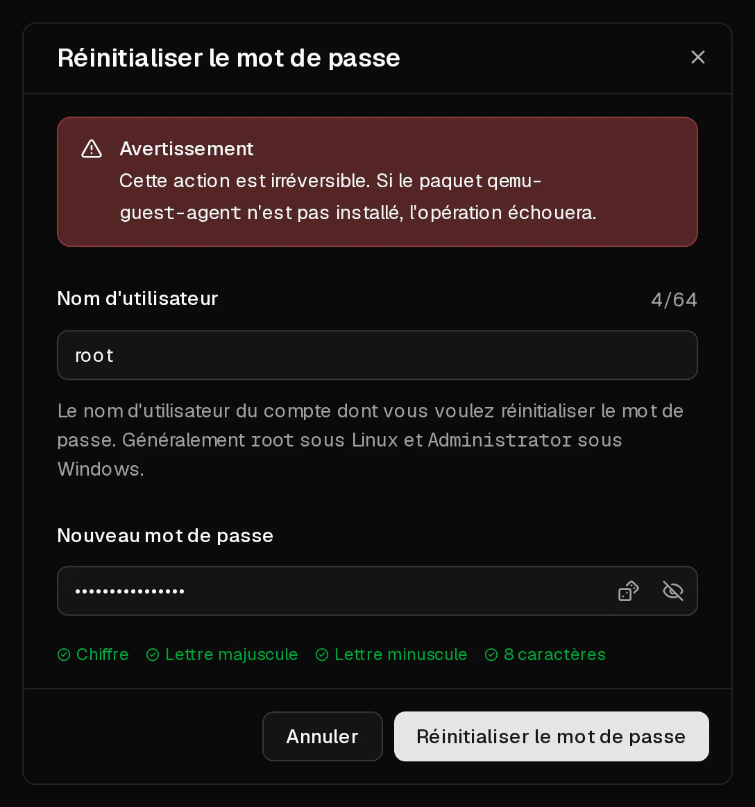

Vous pouvez définir un nouveau mot de passe pour n'importe quel utilisateur de votre serveur depuis le portail client, y compris `root`. Le nouveau mot de passe fonctionne immédiatement. Le serveur n'est pas redémarré et vos données ne sont pas touchées.

Virtbase ne stocke pas votre mot de passe root : nous ne pouvons donc pas vous communiquer l'ancien. Le réinitialiser est le moyen de retrouver l'accès.

## Avant de commencer

- Le serveur est en marche : son statut sur la page <Ui>Aperçu</Ui> est <Ui>En ligne</Ui>.
- L'**agent invité QEMU** tourne à l'intérieur du serveur. Il est installé sur tous les systèmes d'exploitation que vous choisissez lors de la commande. Si vous avez installé le système vous-même depuis une <Term id="iso-image">image ISO</Term>, [installez d'abord l'agent](#la-réinitialisation-échoue).
- Le nouveau mot de passe comporte de 8 à 64 caractères, dont au moins une lettre majuscule, une lettre minuscule et un chiffre.

## Réinitialiser le mot de passe

1. Dans le [portail client](https://app.virtbase.com/servers), cliquez sur <Ui>Voir</Ui> à côté de votre serveur.
2. Sur la page <Ui>Aperçu</Ui>, cliquez sur <Ui>Réinitialiser le mot de passe</Ui> dans la carte <Ui>Serveur</Ui>.
3. Sous <Ui>Nom d'utilisateur</Ui>, saisissez l'utilisateur dont vous voulez changer le mot de passe. Il s'agit généralement de `root` sous Linux et de `Administrator` sous Windows.
4. Sous <Ui>Nouveau mot de passe</Ui>, saisissez le nouveau mot de passe.
5. Cliquez sur <Ui>Réinitialiser le mot de passe</Ui>.



La boîte de dialogue se ferme et le nouveau mot de passe est actif.

## Vérifier que cela a fonctionné

Connectez-vous avec le nouveau mot de passe :

```bash
ssh root@<votre-ip>
```

Ou connectez-vous via la [console du navigateur](/fr/help/article/how-to-use-console) si <Term id="ssh">SSH</Term> n'est pas joignable.

## Si cela n'a pas fonctionné

### La réinitialisation échoue

Le portail affiche <Msg>Impossible de réinitialiser le mot de passe.</Msg> lorsque le serveur n'est pas en marche ou que l'<Term id="guest-agent">agent invité</Term> ne répond pas.

- Démarrez le serveur et attendez environ une minute qu'il ait fini de démarrer, puis réessayez.
- Vérifiez que l'agent tourne. Connectez-vous via la console, si vous le pouvez encore, et exécutez :

  ```bash
  systemctl status qemu-guest-agent
  ```

  S'il est absent, installez-le et démarrez-le :

  ```bash tab="Debian / Ubuntu" tab-group="os"
  apt install qemu-guest-agent
  systemctl enable --now qemu-guest-agent
  ```

  ```bash tab="AlmaLinux / Rocky Linux / Fedora" tab-group="os"
  dnf install qemu-guest-agent
  systemctl enable --now qemu-guest-agent
  ```

  Sous Windows, l'agent fait partie du paquet de pilotes VirtIO (`virtio-win`).

Vous pouvez réinitialiser un mot de passe au maximum trois fois par minute. Si vous voyez <Msg>Vous faites cela trop souvent. Veuillez patienter un instant.</Msg>, attendez une minute et réessayez.

### SSH refuse toujours le nouveau mot de passe

Le mot de passe a bien été changé, mais votre serveur SSH n'accepte pas la connexion de root par mot de passe. Connectez-vous via la console et vérifiez ces deux paramètres dans `/etc/ssh/sshd_config` :

```text title="/etc/ssh/sshd_config"
PasswordAuthentication yes
PermitRootLogin yes
```

Redémarrez ensuite SSH avec `systemctl restart ssh` (ou `sshd`). Utiliser une [clé SSH](https://app.virtbase.com/account/settings/ssh-keys) plutôt qu'un mot de passe est plus sûr et vous évite complètement ce problème.

### Vous ne pouvez plus du tout vous connecter et l'agent n'est pas installé

Sans l'agent, le portail ne peut pas changer le mot de passe. Vous pouvez :

- démarrer un système de secours depuis une image ISO personnalisée et changer le mot de passe depuis celui-ci (voir [Mon serveur ne démarre pas](/fr/help/article/cant-connect-to-server#mon-serveur-ne-démarre-pas)), ou
- [contacter le support](/fr/contact) en indiquant l'<Ui>ID du serveur</Ui>, qui figure dans l'onglet <Ui>Avancé</Ui>, et nous dire si nous pouvons redémarrer le serveur.

[Changer de système d'exploitation](/fr/help/article/how-to-change-operating-system) vous donne aussi un nouveau mot de passe root, mais efface tout le contenu du disque.
