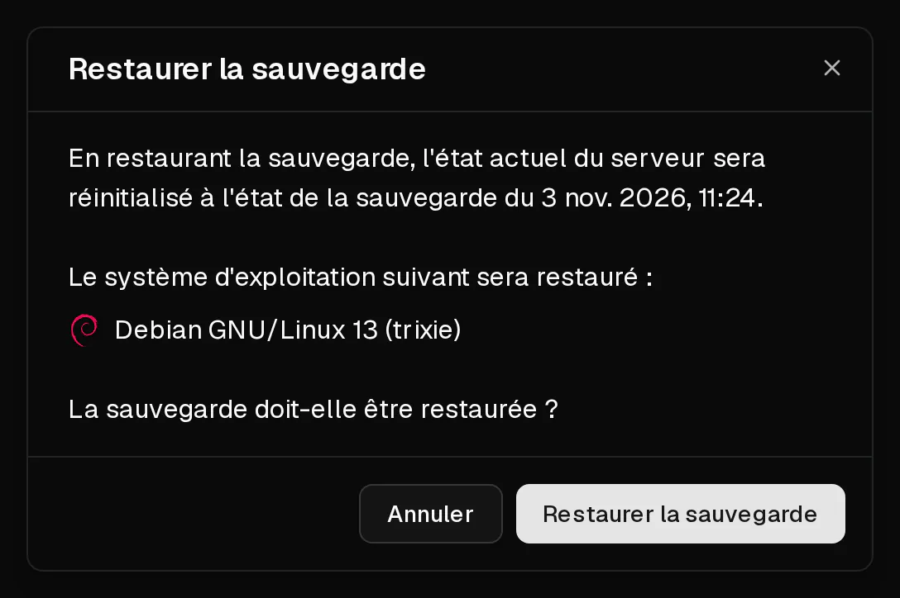

Restaurer une sauvegarde remet le disque de votre serveur dans l'état où il se trouvait au moment de la sauvegarde. **Tout ce qui a été créé ou modifié sur le serveur depuis est perdu.**

Seul le disque est remplacé. Le serveur conserve ses adresses IP, ses règles de pare-feu, ses entrées de <Term id="ptr-record">DNS inversé</Term> et son forfait.

## Avant de commencer

- Si quelque chose a changé sur le serveur depuis la sauvegarde et que vous voulez le conserver, créez d'abord une [nouvelle sauvegarde](/fr/help/article/how-to-backup-server). Vous pourrez ainsi revenir à l'état actuel si nécessaire.
- La sauvegarde doit être terminée. Les sauvegardes qui affichent <Ui>Création...</Ui> ou <Ui>Échec</Ui> ne peuvent pas être restaurées.
- Prévoyez une courte interruption : le serveur est hors ligne pendant la restauration.

## Restaurer la sauvegarde

1. Dans le [portail client](https://app.virtbase.com/servers), cliquez sur <Ui>Voir</Ui> à côté de votre serveur et ouvrez l'onglet <Ui>Sauvegardes</Ui>.
2. Ouvrez le menu de la sauvegarde souhaitée et sélectionnez <Ui>Restaurer</Ui>.
3. Vérifiez la date et le système d'exploitation dans la boîte de dialogue. Le système d'exploitation indiqué est celui qui se trouvera sur le serveur après la restauration.
4. Confirmez la restauration.

Le serveur affiche <Ui>Le serveur est en cours d'installation</Ui> pendant la restauration, puis redémarre une fois l'opération terminée.

## Vérifier que cela a fonctionné

Une fois la bannière disparue, connectez-vous et vérifiez que vos données sont dans l'état attendu.

Lorsque vous vous connectez en <Term id="ssh">SSH</Term>, vous pouvez voir `WARNING: REMOTE HOST IDENTIFICATION HAS CHANGED!` si la sauvegarde provient d'une installation antérieure. C'est normal. Supprimez l'ancienne clé avec `ssh-keygen -R <votre-ip>` et reconnectez-vous.

Le mot de passe root est celui qui était valable au moment de la sauvegarde. Si vous ne le connaissez plus, [réinitialisez-le](/fr/help/article/how-to-reset-root-password).

## Limites

- Vous pouvez restaurer jusqu'à **5 sauvegardes par jour**, tous serveurs confondus.
- Une restauration ne peut pas démarrer tant qu'une autre sauvegarde ou restauration du même serveur est en cours.
- La restauration n'est pas possible tant que le serveur est suspendu, ni tant qu'un dossier d'abus le restreint.

## Si cela n'a pas fonctionné

- <Msg>Impossible de restaurer la sauvegarde.</Msg> Une sauvegarde ou une restauration est encore en cours, vous avez atteint la limite quotidienne, ou le serveur est suspendu. Patientez et réessayez.
- **Le serveur ne démarre pas après la restauration** : ouvrez la [console](/fr/help/article/how-to-use-console) pour voir ce qui se passe au démarrage, et consultez [Impossible de se connecter à mon serveur](/fr/help/article/cant-connect-to-server).
- **La restauration semble bloquée** : si le serveur affiche toujours <Ui>Le serveur est en cours d'installation</Ui> au bout d'une heure, [contactez le support](/fr/contact) en indiquant l'<Ui>ID du serveur</Ui> et le nom de la sauvegarde.
