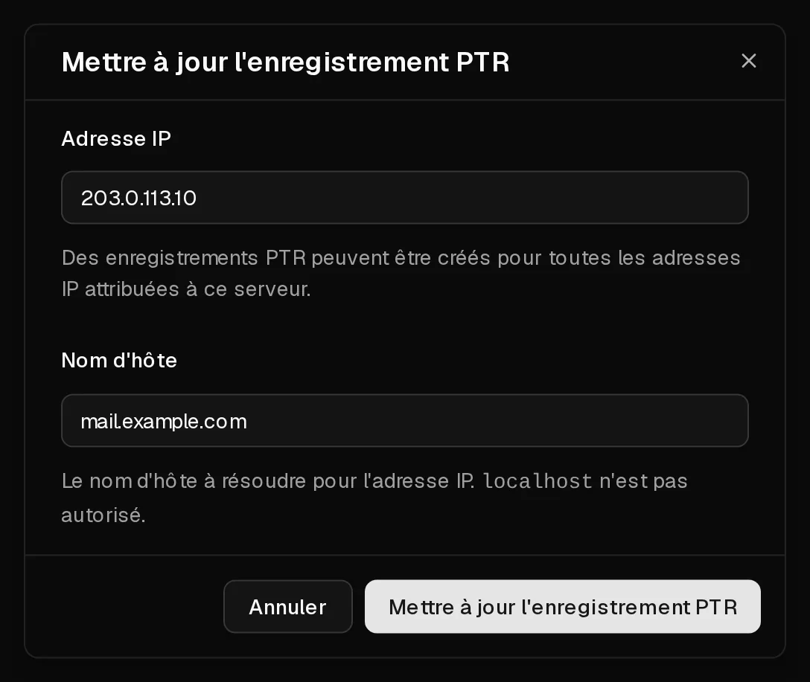

Le DNS inversé répond à la question « Quel nom d'hôte correspond à cette adresse IP ? ». Il se définit à l'aide d'un <Term id="ptr-record">enregistrement PTR</Term>. Dans l'onglet <Ui>rDNS</Ui>, vous pouvez en définir un pour l'<Term id="ipv4">adresse IPv4</Term> de votre serveur et pour n'importe quelle adresse de son <Term id="ipv6-subnet">sous-réseau IPv6 /64</Term>.

La plupart des utilisateurs en ont besoin pour une seule raison : **l'envoi d'e-mails**. De nombreux serveurs de messagerie rejettent ou signalent comme suspects les e-mails provenant d'une adresse sans enregistrement PTR, ou d'une adresse dont l'enregistrement PTR ne correspond pas.

## Avant de commencer

Créez d'abord, chez votre fournisseur de domaine, un enregistrement DNS pour le nom d'hôte, pointant vers le serveur :

- un enregistrement **A** pour l'adresse IPv4, par exemple `mail.example.com` → `203.0.113.10`,
- un enregistrement **AAAA** si vous utilisez aussi l'IPv6.

L'enregistrement PTR et cet enregistrement doivent pointer l'un vers l'autre. C'est cette correspondance, appelée DNS inversé confirmé par le DNS direct (forward-confirmed reverse DNS), que vérifient les serveurs de messagerie destinataires.

## Définir un enregistrement PTR

1. Dans le [portail client](https://app.virtbase.com/servers), cliquez sur <Ui>Voir</Ui> à côté de votre serveur et ouvrez l'onglet <Ui>rDNS</Ui>.
2. Cliquez sur l'icône en forme de crayon à côté de <Ui>Enregistrements PTR</Ui>.
3. Sous <Ui>Adresse IP</Ui>, saisissez l'adresse, par exemple `203.0.113.10` ou `2001:db8::10`.
4. Sous <Ui>Nom d'hôte</Ui>, saisissez le nom d'hôte complet en minuscules, par exemple `mail.example.com`.
5. Cliquez sur <Ui>Mettre à jour l'enregistrement PTR</Ui>.



L'enregistrement apparaît dans le tableau. Pour le modifier, répétez les étapes avec la même adresse IP et un nouveau nom d'hôte.

## Vérifier que cela a fonctionné

Recherchez l'adresse depuis votre ordinateur ou depuis le serveur :

```bash
dig -x 203.0.113.10 +short
```

La commande renvoie votre nom d'hôte, suivi d'un point : `mail.example.com.`. Les autres résolveurs DNS peuvent conserver l'ancienne réponse en cache pendant un certain temps.

## Supprimer un enregistrement PTR

Cliquez sur l'icône de corbeille dans la ligne de l'enregistrement, puis confirmez. L'adresse ne renvoie alors plus vers votre nom d'hôte, et les e-mails envoyés depuis celle-ci risquent d'être rejetés.

## Envoyer des e-mails depuis votre serveur

Le port 25 sortant est ouvert sur les serveurs Virtbase : votre serveur peut donc distribuer les e-mails directement. Pour que vos e-mails arrivent à destination sans finir dans les spams, le DNS inversé ne suffit pas :

- un **enregistrement PTR** correspondant à un enregistrement **A**/**AAAA**, comme décrit ci-dessus,
- des enregistrements **SPF**, **DKIM** et **DMARC** pour votre domaine,
- un serveur de messagerie qui s'identifie avec le même nom d'hôte (pour Postfix, `myhostname` dans `/etc/postfix/main.cf`).

L'envoi de spam, ou d'e-mails depuis un serveur compromis, entraîne des [signalements d'abus](/fr/help/article/about-abuse-reports) et peut faire inscrire votre adresse sur des listes noires.

## Si cela n'a pas fonctionné

- <Msg>Impossible d'enregistrer l'enregistrement PTR.</Msg> Vérifiez que l'adresse IP appartient bien à ce serveur et que le nom d'hôte est un nom complet (FQDN) valide, en minuscules. `localhost` n'est pas autorisé.
- <Msg>Vous faites cela trop souvent. Veuillez patienter un instant.</Msg> Vous pouvez enregistrer jusqu'à 10 enregistrements PTR par heure. Patientez et réessayez.
- **L'onglet rDNS ne peut pas être modifié** : les enregistrements PTR ne peuvent pas être modifiés tant que le serveur est suspendu. [Renouvelez d'abord le serveur](/fr/help/article/how-to-renew-server).

Lorsqu'un serveur est supprimé, ses enregistrements PTR sont supprimés avec lui.
