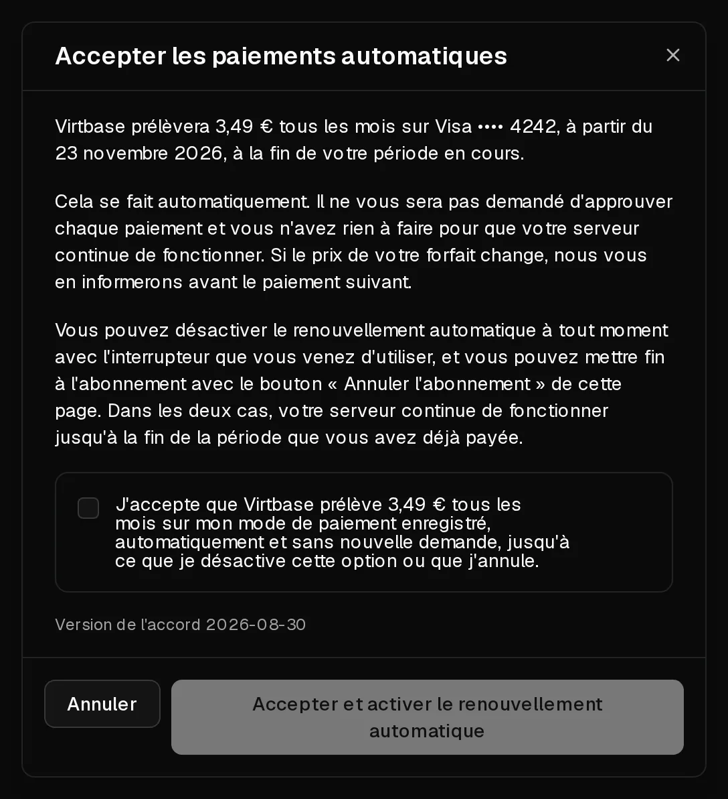

Avec le renouvellement automatique, votre serveur se renouvelle tout seul à la fin de chaque période : nous débitons votre carte enregistrée et le serveur continue de fonctionner sans que vous ayez à intervenir. Sans renouvellement automatique, le serveur s'arrête à la fin de la période, sauf si vous le [renouvelez manuellement](/fr/help/article/how-to-renew-server).

## Avant de commencer

Vous avez besoin d'un moyen de paiement enregistré. Pour en ajouter un, ouvrez [Compte > Facturation](https://app.virtbase.com/account/settings/billing), cliquez sur <Ui>Ajouter une carte</Ui>, saisissez la carte et cliquez sur <Ui>Enregistrer la carte</Ui>. Rien n'est prélevé lors de l'ajout.

Les paiements en cryptomonnaie ne peuvent pas être enregistrés : le renouvellement automatique n'est donc pas disponible avec ce moyen de paiement.

## Activer le renouvellement automatique

1. Dans le [portail client](https://app.virtbase.com/servers), cliquez sur <Ui>Voir</Ui> à côté de votre serveur et ouvrez l'onglet <Ui>Forfait</Ui>.
2. Sous <Ui>Renouvellement automatique</Ui>, activez l'interrupteur.
3. Lisez l'accord dans la boîte de dialogue <Ui>Accepter les paiements automatiques</Ui>. Elle indique le montant, la carte et la date du premier prélèvement.
4. Cochez la case et cliquez sur <Ui>Accepter et activer le renouvellement automatique</Ui>.

La carte du forfait affiche désormais <Ui>Se renouvelle automatiquement le</Ui> suivi de la date de fin de votre période en cours. Le premier prélèvement a lieu à cette date, et non aujourd'hui.

Le renouvellement automatique se règle serveur par serveur. Répétez ces étapes pour chaque serveur que vous voulez renouveler automatiquement.

## Changer la carte débitée

Les renouvellements sont prélevés sur la carte désignée pour les renouvellements. Pour la changer, ouvrez [Compte > Facturation](https://app.virtbase.com/account/settings/billing) et cliquez sur <Ui>Utiliser pour les renouvellements</Ui> à côté d'une autre carte. L'onglet <Ui>Forfait</Ui> de chaque serveur indique la carte qu'il utilise.

## Désactiver le renouvellement automatique

Désactivez l'interrupteur sous <Ui>Renouvellement automatique</Ui> dans l'onglet <Ui>Forfait</Ui>. Le serveur continue de fonctionner jusqu'à la fin de la période que vous avez payée. Ensuite, il s'arrête, sauf si vous le renouvelez manuellement.

## Annuler l'abonnement

L'annulation met fin au serveur à la fin de la période en cours.

1. Dans l'onglet <Ui>Forfait</Ui>, cliquez sur <Ui>Annuler l'abonnement</Ui> sous <Ui>Annulation</Ui>.
2. Confirmez avec <Ui>Annuler l'abonnement maintenant</Ui>.

Rien n'est éteint aujourd'hui et vous ne serez plus débité. Le serveur fonctionne jusqu'à la date indiquée, puis il est arrêté et, 5 jours plus tard, supprimé avec toutes ses données et ses sauvegardes. Téléchargez d'ici là tout ce que vous voulez conserver.

Vous avez changé d'avis ? Cliquez sur <Ui>Reprendre l'abonnement</Ui> avant la fin de la période. La reprise ne réactive pas le renouvellement automatique : activez donc de nouveau l'interrupteur ensuite.

## Si cela n'a pas fonctionné

- <Msg>Ajoutez d'abord un mode de paiement. Le renouvellement automatique nécessite une carte que nous puissions prélever à la fin de votre période.</Msg> Ajoutez une carte dans <Ui>Compte</Ui> › <Ui>Facturation</Ui>, puis réessayez.
- <Msg>Le mode de paiement que nous prélèverions ne peut pas être utilisé.</Msg> La carte a expiré ou a été refusée. Choisissez une autre carte avec <Ui>Utiliser pour les renouvellements</Ui>.
- <Msg>Reprenez cet abonnement avant de réactiver le renouvellement automatique.</Msg> L'abonnement a été annulé. Cliquez d'abord sur <Ui>Reprendre l'abonnement</Ui>.
- <Msg>La période payée est terminée.</Msg> Un abonnement ne peut être repris que tant que sa période est encore en cours. [Renouvelez plutôt le serveur manuellement](/fr/help/article/how-to-renew-server), tant qu'il n'a pas encore été supprimé.

Si un paiement de renouvellement échoue, consultez [Le paiement de mon renouvellement a échoué](/fr/help/article/failed-payment).
