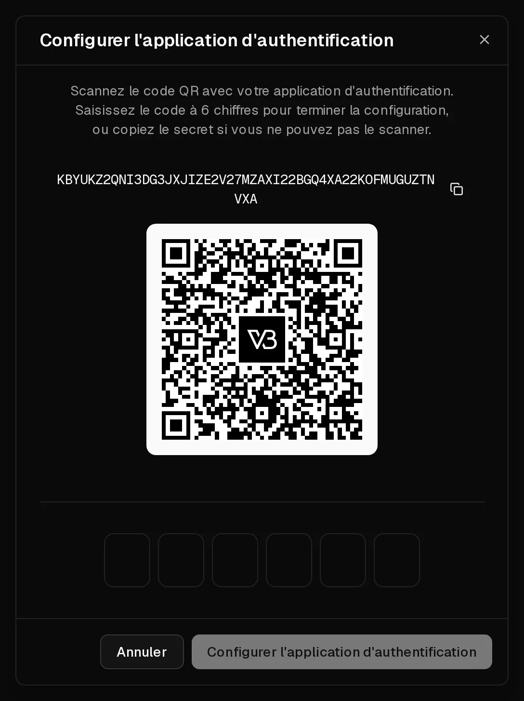

Votre compte Virtbase contrôle vos serveurs : il mérite donc mieux qu'un simple mot de passe. Sur la page <Ui>Sécurité</Ui> de votre compte, vous pouvez :

- exiger un code d'une **application d'authentification** à la connexion (<Term id="two-factor-authentication">authentification à deux facteurs</Term>),
- vous connecter avec une **clé d'accès** au lieu d'un mot de passe,
- lier <Ui>Google</Ui>, <Ui>GitHub</Ui> ou <Ui>Discord</Ui> pour vous connecter,
- voir où vous êtes connecté, et déconnecter les autres appareils.

## Configurer l'authentification à deux facteurs

Vous avez besoin d'une application d'authentification comme 1Password, Google Authenticator ou Microsoft Authenticator.

1. Ouvrez [Compte > Sécurité](https://app.virtbase.com/account/settings/authentication).
2. Sous <Ui>Authentification à deux facteurs</Ui>, cliquez sur <Ui>Configurer</Ui> à côté de <Ui>Application d'authentification (TOTP)</Ui>.
3. Confirmez avec votre mot de passe.
4. Scannez le code QR avec votre application. Si vous ne pouvez pas le scanner, copiez plutôt la clé secrète dans l'application.
5. Saisissez le code à 6 chiffres affiché par l'application et confirmez.

<Ui>Application d'authentification (TOTP)</Ui> affiche désormais <Ui>Configurée</Ui>. À partir de maintenant, après votre mot de passe, le code actuel de votre application vous est demandé.

Vos <Ui>Codes de récupération</Ui> sont affichés sous <Ui>Authentification à deux facteurs</Ui>. Conservez-les dans un gestionnaire de mots de passe ou imprimez-les. Cliquez sur <Ui>Régénérer</Ui> pour les remplacer par de nouveaux codes.

Pour transférer l'authentification à deux facteurs sur un nouveau téléphone, cliquez sur <Ui>Remplacer</Ui> et scannez le nouveau code QR avec le nouveau téléphone.

## Ajouter une clé d'accès

Une <Term id="passkey">clé d'accès</Term> vous connecte grâce à votre empreinte digitale, votre visage, le code PIN de votre appareil ou une clé de sécurité, et elle est insensible au phishing.

1. Sur la page <Ui>Sécurité</Ui>, cliquez sur <Ui>Ajouter une clé d'accès</Ui> sous <Ui>Clés d'accès</Ui>.
2. Suivez les instructions de votre navigateur ou de votre appareil.

Pour vous connecter avec, cliquez sur <Ui>Continuer avec une clé d'accès</Ui> sur la page de connexion. Vous pouvez enregistrer plusieurs clés d'accès, par exemple une sur votre ordinateur portable et une sur votre téléphone.

## Se connecter avec Google, GitHub ou Discord

Sous <Ui>Méthodes d'authentification</Ui>, cliquez sur <Ui>Lier</Ui> à côté d'un fournisseur et confirmez auprès de ce fournisseur. Vous pourrez ensuite vous connecter avec lui. Lier Discord vous permet aussi d'utiliser le [bot Discord](/fr/help/article/discord-integration). Cliquez sur <Ui>Dissocier</Ui> pour retirer un fournisseur.

## Déconnecter les autres appareils

<Ui>Sessions actives</Ui> liste tous les appareils connectés à votre compte, avec leur adresse IP et l'heure de connexion. Cliquez sur <Ui>Se déconnecter</Ui> à côté de toute session que vous ne reconnaissez pas.

Les sessions se terminent d'elles-mêmes 3 jours après la dernière connexion. Réinitialiser votre mot de passe avec <Msg>Mot de passe oublié ?</Msg> déconnecte toutes les sessions.

Si vous voyez une session que vous ne reconnaissez pas, déconnectez-la, [changez votre mot de passe](/fr/help/article/how-to-change-account-settings) et vérifiez vos [clés API](/fr/help/article/how-to-use-public-api).

## Si cela n'a pas fonctionné

- <Msg>Code invalide. Veuillez réessayer.</Msg> Vérifiez que l'heure de votre téléphone est réglée automatiquement : les codes d'authentification dépendent de l'heure exacte. Saisissez le code affiché maintenant, et non un code sur le point de changer.
- **Vous avez perdu le téléphone sur lequel se trouve votre application d'authentification** : connectez-vous avec une clé d'accès si vous en avez enregistré une, puis cliquez sur <Ui>Remplacer</Ui> pour configurer l'application sur votre nouveau téléphone. Sans clé d'accès, [contactez le support](/fr/contact) depuis l'adresse e-mail de votre compte.
- **L'invite de clé d'accès n'apparaît pas** : votre navigateur ou votre appareil ne prend peut-être pas en charge les clés d'accès. Utilisez un navigateur à jour, ou un autre appareil.
