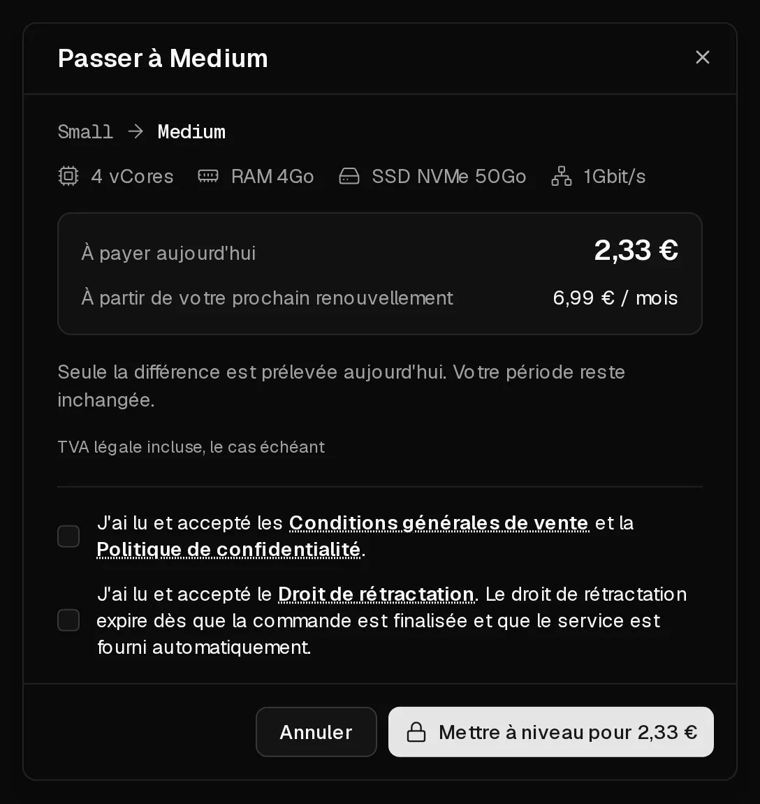

Vous pouvez faire passer votre serveur à un forfait supérieur à tout moment depuis son onglet <Ui>Forfait</Ui>. Vos données, vos adresses IP et vos paramètres restent inchangés. Le serveur redémarre une fois pour prendre en compte les nouvelles ressources.

## Combien cela coûte

Vous ne payez que la **différence** entre les deux forfaits pour le temps restant de votre période en cours. Votre période ne change pas. À partir du renouvellement suivant, vous payez le prix du nouveau forfait.

**Exemple :** votre forfait coûte 6 € par mois et le nouveau 10 €. S'il reste 15 jours sur votre période de 30 jours, la mise à niveau vous coûte aujourd'hui (10 € − 6 €) × 15 ÷ 30 = **2 €**. Le montant minimum facturé est de 0,50 €.

Avant que vous ne payiez, la boîte de dialogue affiche le montant exact sous <Ui>À payer aujourd'hui</Ui> et le prix futur sous <Ui>Prix de renouvellement</Ui>.

## Avant de commencer

- **Éteignez proprement le serveur** avec <Ui>Éteindre</Ui> dans le portail ou avec `poweroff` à l'intérieur du serveur. Sinon, la mise à niveau coupe le serveur sans attendre les applications, ce qui peut entraîner la perte de données non enregistrées.
- Facultatif : créez une [sauvegarde](/fr/help/article/how-to-backup-server).

## Passer à un forfait supérieur

1. Dans le [portail client](https://app.virtbase.com/servers), cliquez sur <Ui>Voir</Ui> à côté de votre serveur et ouvrez l'onglet <Ui>Forfait</Ui>.
2. Choisissez un forfait supérieur et cliquez sur <Ui>Mettre à niveau</Ui>.
3. Vérifiez <Ui>À payer aujourd'hui</Ui> et <Ui>Prix de renouvellement</Ui>, puis cliquez sur <Ui>Mettre à niveau pour</Ui> suivi du montant affiché.
4. Choisissez un mode de paiement et cliquez sur <Ui>Payer maintenant</Ui>.



Après le paiement, le disque est agrandi et le serveur est démarré avec les nouvelles ressources, même si vous l'aviez éteint auparavant. Cela prend quelques minutes.

## Vérifier que cela a fonctionné

La page <Ui>Aperçu</Ui> affiche le nouveau nombre de <Term id="vcore">vCores</Term> et la nouvelle quantité de mémoire. À l'intérieur du serveur, vérifiez :

```bash
nproc       # nombre de cœurs de processeur
free -h     # mémoire
df -h /     # espace disque libre
```

Sur nos systèmes d'exploitation prêts à l'emploi, la partition et le système de fichiers s'agrandissent automatiquement au démarrage du serveur. Si `df -h /` affiche toujours l'ancienne taille, par exemple sur un système que vous avez installé depuis une ISO, agrandissez-les manuellement :

```bash tab="ext4" tab-group="filesystem"
growpart /dev/sda 1
resize2fs /dev/sda1
```

```bash tab="XFS" tab-group="filesystem"
growpart /dev/sda 1
xfs_growfs /
```

Le numéro de partition et le système de fichiers peuvent être différents sur votre système. `lsblk -f` vous les indique.

## Puis-je passer à un forfait inférieur ?

Non. Vous ne pouvez passer qu'à un forfait plus cher et doté d'au moins autant de stockage, car un disque ne peut pas être réduit en toute sécurité. Pour passer à un forfait plus petit, commandez un nouveau serveur, transférez-y vos données et [annulez l'ancien](/fr/help/article/how-to-set-up-automatic-renewal#annuler-labonnement).

## Si cela n'a pas fonctionné

- <Ui>Moins de stockage que votre forfait</Ui> : ce forfait a un disque plus petit que le vôtre et ne peut pas être choisi.
- <Ui>Épuisé</Ui> : le forfait n'est pas disponible sur le matériel de votre serveur pour le moment. Réessayez plus tard.
- <Msg>Votre période en cours a expiré. Renouvelez d'abord votre serveur, puis effectuez la mise à niveau.</Msg> [Renouvelez le serveur](/fr/help/article/how-to-renew-server), puis passez au forfait supérieur.
- <Ui>Aucun forfait disponible</Ui> : il n'existe pas de forfait supérieur sur le matériel sur lequel tourne votre serveur.
- <Msg>Les nouvelles commandes sont suspendues tant qu'un dossier d'abus est ouvert.</Msg> Les mises à niveau sont suspendues jusqu'à la clôture du [dossier d'abus](/fr/help/article/about-abuse-reports).
- <Ui>Une commande est en attente de paiement</Ui> : cliquez sur <Ui>Reprendre le paiement</Ui>, ou sur <Ui>L'abandonner</Ui> pour recommencer.
