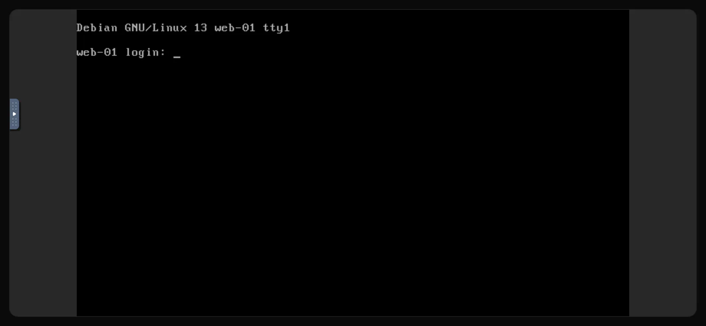

La console, c'est l'écran et le clavier de votre serveur dans un onglet du navigateur. Elle se connecte directement à la machine virtuelle plutôt qu'en passant par son réseau : elle fonctionne donc même lorsque <Term id="ssh">SSH</Term> ne fonctionne pas, par exemple après une erreur de pare-feu, avec une configuration réseau cassée, ou pendant le démarrage d'un système d'exploitation ou son installation depuis une <Term id="iso-image">image ISO</Term>.

## Ouvrir la console

1. Dans le [portail client](https://app.virtbase.com/servers), cliquez sur <Ui>Voir</Ui> à côté de votre serveur.
2. Ouvrez l'onglet <Ui>Console</Ui>.

La console se connecte d'elle-même au bout de quelques secondes. Si vous voyez <Ui>Le serveur ne fonctionne pas</Ui>, démarrez le serveur ; la console se connecte dès qu'il est en marche.

La console n'est pas disponible pendant l'installation du serveur, lorsqu'il est suspendu ou pendant la création d'une sauvegarde. L'onglet vous indique laquelle de ces situations s'applique.

## Se connecter

Connectez-vous avec l'utilisateur `root` et votre mot de passe root. Sous Windows, utilisez le compte `Administrator`.

Si vous ne connaissez pas le mot de passe, [réinitialisez-le](/fr/help/article/how-to-reset-root-password) d'abord dans le portail client. Un mot de passe saisi dans la console ne s'affiche pas à l'écran, c'est normal.

## Touches spéciales, plein écran et reconnexion

La console utilise [noVNC](https://novnc.com). Sa barre de contrôle se trouve sur le bord gauche de la console : cliquez sur le petit onglet pour l'ouvrir.

- <Ui>Touches supplémentaires</Ui> envoie des combinaisons de touches que votre propre ordinateur intercepterait, comme <Ui>Ctrl+Alt+Suppr</Ui>, ou <Ui>Échap</Ui> et <Ui>Tab</Ui>.
- <Ui>Plein écran</Ui> agrandit la console à tout l'écran.
- <Ui>Déconnecter</Ui> ferme la connexion. Rechargez la page pour vous reconnecter.

Si la console ne répond plus, rechargez la page. La connexion est renouvelée automatiquement tant que l'onglet reste ouvert.

## Si cela n'a pas fonctionné

### Les caractères saisis ne sont pas les bons

Si certaines touches produisent d'autres caractères que prévu, par exemple si deux lettres sont inversées par rapport à votre clavier (comme `a` et `q` ou `z` et `w` sur un clavier AZERTY), la disposition de clavier de votre ordinateur diffère de celle qu'attend la console. Tapez en vous basant sur la disposition américaine (QWERTY US), ou définissez un mot de passe temporaire composé uniquement de lettres et de chiffres situés au même endroit sur les deux dispositions. Changez-le ensuite via SSH.

### Le collage ne fonctionne pas

Le texte de votre presse-papiers n'est pas saisi dans le serveur : le collage ne fonctionne donc pas pour les mots de passe ni pour les commandes. Tapez-les à la main, ou connectez-vous en [SSH](/fr/help/article/how-to-connect-to-server), où le copier-coller fonctionne normalement.

### L'écran est noir

Le serveur est peut-être en veille ou affiche un écran de veille vide. Appuyez sur une touche, ou déplacez la souris sur la console. S'il reste noir, vérifiez le statut sur la page <Ui>Aperçu</Ui> et consultez [Impossible de se connecter à mon serveur](/fr/help/article/cant-connect-to-server).

## La console depuis Discord

Si vous utilisez le [bot Discord](/fr/help/article/discord-integration), <Ui>/menu</Ui> permet d'ouvrir un lien de console à usage unique. Le lien est valable 10 secondes : ouvrez-le immédiatement.
