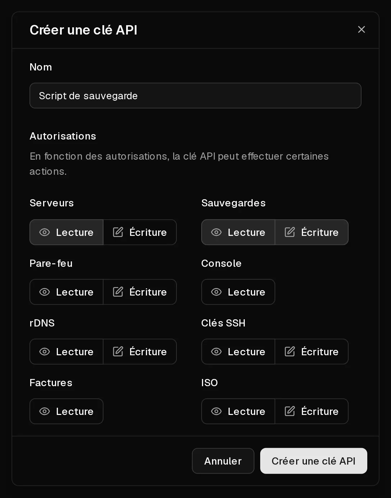

L'API Virtbase vous permet de gérer vos serveurs depuis vos propres scripts et outils : actions d'alimentation, sauvegardes, règles de pare-feu, <Term id="ptr-record">DNS inversé</Term>, <Term id="ssh-key">clés SSH</Term>, <Term id="iso-image">images ISO</Term> et factures. Vous authentifiez chaque requête avec une <Term id="api-key">clé API</Term>.

La référence complète, avec chaque endpoint et un client interactif, se trouve dans la [documentation de l'API](/api/docs).

## Créer une clé API

1. Dans le [portail client](https://app.virtbase.com/account/settings/api), ouvrez <Ui>Compte</Ui> › <Ui>API</Ui>.
2. Cliquez sur <Ui>Créer une clé API</Ui>.
3. Sous <Ui>Nom</Ui>, indiquez à quoi sert la clé, par exemple `Script de sauvegarde`.
4. Sous <Ui>Autorisations</Ui>, choisissez <Ui>Lecture</Ui> ou <Ui>Écriture</Ui> pour chaque domaine dont la clé a besoin : <Ui>Serveurs</Ui>, <Ui>Sauvegardes</Ui>, <Ui>Pare-feu</Ui>, <Ui>Console</Ui>, <Ui>rDNS</Ui>, <Ui>Clés SSH</Ui>, <Ui>Factures</Ui> et <Ui>ISO</Ui>. Laissez tout le reste désactivé.
5. Cliquez sur <Ui>Créer une clé API</Ui>.
6. Copiez la clé depuis <Ui>Clé API créée</Ui> et conservez-la en lieu sûr, par exemple dans un gestionnaire de mots de passe.



<Hint>
La clé n'est affichée qu'une seule fois et ne peut plus être affichée ensuite. Si vous la perdez, supprimez-la et créez-en une nouvelle.
</Hint>

Les clés API sont valables **un an** à compter du jour de leur création. Créez une nouvelle clé avant cette échéance et remplacez l'ancienne dans vos scripts.

## Envoyer une requête

Placez la clé dans l'en-tête `X-Virtbase-API-Key` de chaque requête. Par exemple, pour lister vos serveurs :

```bash
curl https://virtbase.com/api/v1/servers \
  -H "X-Virtbase-API-Key: $VIRTBASE_API_KEY"
```

Les listes sont paginées avec les paramètres de requête `page` (à partir de 1) et `per_page` (10 par défaut, 100 au maximum). De nombreuses listes peuvent être triées avec `sort`, par exemple `sort=name:asc`.

## Limites de requêtes

Vous pouvez envoyer jusqu'à **120 requêtes par minute**. Certaines actions ont leurs propres limites, plus strictes, par exemple 5 actions d'alimentation par minute ou 5 sauvegardes par jour.

Chaque réponse vous indique où vous en êtes :

- `X-RateLimit-Limit` : le nombre de requêtes autorisées dans la fenêtre,
- `X-RateLimit-Remaining` : le nombre de requêtes qu'il vous reste,
- `X-RateLimit-Reset` : le moment où la totalité du quota est de nouveau disponible, sous forme d'horodatage Unix.

Lorsque vous dépassez une limite, l'API répond `429 Too Many Requests`. Attendez l'heure de réinitialisation avant de réessayer. Si vous avez besoin d'une limite plus élevée, [contactez le support](/fr/contact) et décrivez ce que vous développez.

## Ce que l'API ne permet pas de faire

Pour votre sécurité, certaines actions ne sont possibles que dans le portail client, lorsque vous y êtes connecté :

- commander, renouveler et mettre à niveau des serveurs,
- gérer les moyens de paiement et les abonnements,
- répondre aux signalements d'abus,
- exporter vos données et supprimer votre compte.

## Protéger vos clés

- Donnez à chaque script sa propre clé, avec uniquement les autorisations dont il a besoin. Une clé qui ne fait que lire les factures ne peut pas supprimer un serveur.
- Ne placez jamais une clé dans le code source ou dans un dépôt public. Utilisez une variable d'environnement ou un gestionnaire de secrets.
- Supprimez les clés que vous n'utilisez plus dans <Ui>Compte</Ui> › <Ui>API</Ui>.

Si une clé a fuité, supprimez-la immédiatement et créez-en une nouvelle.

## Si cela n'a pas fonctionné

- **`401 Unauthorized`** : la clé est absente, mal saisie, supprimée ou expirée.
- **`403 Forbidden`** : la clé n'a pas l'autorisation nécessaire pour cette action, l'action n'est disponible que dans le portail, ou le serveur est dans un état qui ne la permet pas, par exemple en cours d'installation ou suspendu.
- **`429 Too Many Requests`** : vous avez atteint une limite de requêtes. Voir ci-dessus.
