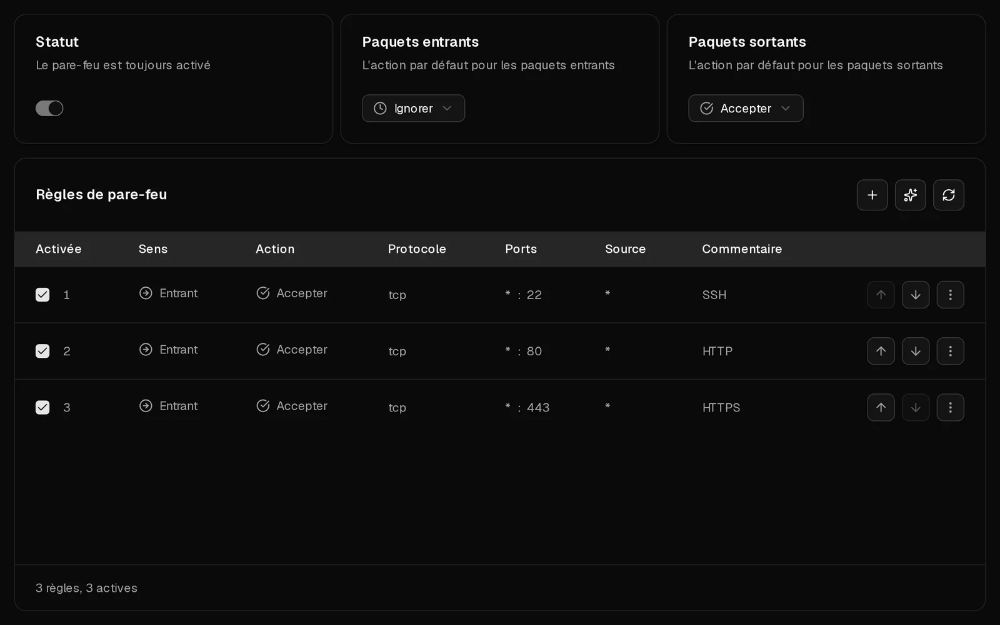
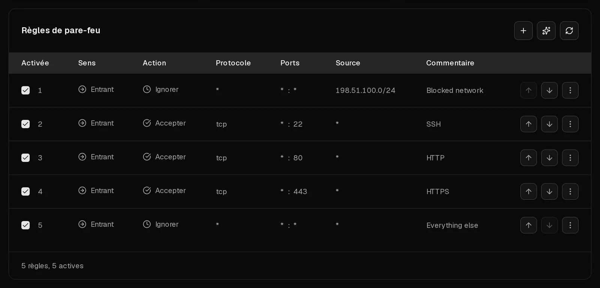

Chaque serveur Virtbase est précédé d'un pare-feu que vous contrôlez dans l'onglet <Ui>Pare-feu</Ui>. Il filtre le trafic avant qu'il n'atteigne votre serveur : il protège donc aussi un serveur dont le propre pare-feu est mal configuré.

Le pare-feu est toujours actif. **Les nouveaux serveurs acceptent tout le trafic dans les deux sens.** Pour protéger un serveur, réglez le trafic entrant sur <Ui>Ignorer</Ui> et n'autorisez que les ports que vous utilisez réellement.

## Avant de commencer : ne vous bloquez pas l'accès

Si vous réglez le trafic entrant par défaut sur <Ui>Ignorer</Ui> avant qu'une règle n'autorise votre port <Term id="ssh">SSH</Term>, votre session SSH cesse de fonctionner. Créez d'abord la règle pour le port 22. Si cela arrive malgré tout, la [console](/fr/help/article/how-to-use-console) fonctionne toujours, et vous pouvez corriger les règles dans le portail à tout moment.

## Protéger un nouveau serveur en quatre étapes

1. Dans le [portail client](https://app.virtbase.com/servers), cliquez sur <Ui>Voir</Ui> à côté de votre serveur et ouvrez l'onglet <Ui>Pare-feu</Ui>.
2. Créez une règle qui autorise SSH : cliquez sur <Ui>+</Ui>, puis réglez <Ui>Sens</Ui> sur <Ui>Entrant</Ui>, <Ui>Action</Ui> sur <Ui>Accepter</Ui>, <Ui>Protocole</Ui> sur <Ui>TCP</Ui> et <Ui>Port de destination</Ui> sur `22`. Saisissez un <Ui>Commentaire</Ui> comme `SSH` et cliquez sur <Ui>Créer une règle de pare-feu</Ui>.
3. Ajoutez une règle de ce type pour chaque autre service qui doit être joignable, par exemple `80` et `443` pour un site web.
4. Réglez <Ui>Paquets entrants</Ui> sur <Ui>Ignorer</Ui>.

Les modifications prennent effet en quelques secondes. Les réponses aux connexions que votre serveur a lui-même ouvertes, comme les téléchargements de paquets, sont toujours autorisées : vous pouvez donc laisser <Ui>Paquets sortants</Ui> sur <Ui>Accepter</Ui>.

## Créer une règle

Cliquez sur <Ui>+</Ui> au-dessus de la liste des règles et renseignez :

| Champ | Ce qu'il faut saisir |
| --- | --- |
| <Ui>Sens</Ui> | <Ui>Entrant</Ui> pour le trafic à destination de votre serveur, <Ui>Sortant</Ui> pour le trafic qu'il envoie. |
| <Ui>Action</Ui> | <Ui>Accepter</Ui>, <Ui>Ignorer</Ui> ou <Ui>Rejeter</Ui> (voir ci-dessous). |
| <Ui>Protocole</Ui> | Généralement <Ui>TCP</Ui> ou <Ui>UDP</Ui>. Choisissez <Ui>ICMP</Ui> pour filtrer les pings, puis sélectionnez un <Ui>Type ICMP</Ui>. |
| <Ui>Port de destination</Ui> | Un seul port, comme `443`, ou une plage, comme `8000:8100`. |
| <Ui>Source</Ui> | Facultatif. Une adresse ou un réseau, comme `198.51.100.7` ou `10.0.0.0/8`. Laissez vide pour que la règle s'applique à tout le monde. |
| <Ui>Commentaire</Ui> | Facultatif, 64 caractères maximum. Notez à quoi sert la règle. |
| <Ui>Activée</Ui> | Désactivez-la pour conserver une règle sans l'appliquer. |

Pour modifier une règle, sélectionnez <Ui>Modifier</Ui> dans son menu. Pour la retirer, sélectionnez <Ui>Supprimer</Ui>.

## Accepter, Ignorer ou Rejeter ?

- <Ui>Accepter</Ui> laisse passer le trafic.
- <Ui>Ignorer</Ui> l'écarte silencieusement. L'expéditeur attend, puis finit par abandonner (timeout).
- <Ui>Rejeter</Ui> l'écarte et prévient l'expéditeur, qui voit immédiatement « connection refused ».

Utilisez <Ui>Ignorer</Ui> pour bloquer le trafic venant d'Internet : cette action ne révèle rien sur les services qui tournent sur votre serveur. <Ui>Rejeter</Ui> est utile au sein de vos propres réseaux, où vous voulez que les connexions refusées échouent rapidement.

## Dans quel ordre les règles sont-elles appliquées ?

Les règles sont vérifiées **de haut en bas**. La première règle activée qui correspond détermine ce qui se passe, et les suivantes sont ignorées. Si aucune règle ne correspond, c'est l'action par défaut de ce sens qui s'applique : <Ui>Paquets entrants</Ui> ou <Ui>Paquets sortants</Ui>.

C'est pourquoi l'ordre est important. Une règle qui ignore le port 22 pour tout le monde, placée au-dessus d'une règle qui accepte le port 22 depuis votre bureau, bloque aussi votre bureau. Placez les règles spécifiques au-dessus des règles générales, et déplacez les règles avec <Ui>Monter</Ui> et <Ui>Descendre</Ui> dans leur menu.

## Recommandations

Lorsque l'<Term id="guest-agent">agent invité QEMU</Term> tourne dans un serveur Linux, Virtbase compare les services à l'écoute sur votre serveur avec vos règles et affiche des <Ui>Recommandations</Ui> :

- **Un service est accessible depuis Internet** : une base de données, Redis, l'API Docker ou un service similaire est ouvert à tout le monde. Cliquez sur <Ui>Créer une règle</Ui> pour le bloquer, sauf si vous vouliez le rendre public.
- **Un port est bloqué dans votre serveur** : votre règle Virtbase autorise un port, mais le pare-feu de votre serveur le bloque, si bien que le trafic n'arrive jamais.
- **Rien n'écoute sur un port** : une règle ouvre un port qu'aucun service n'utilise. Cliquez sur <Ui>Supprimer la règle</Ui> pour faire le ménage.

SSH, HTTP et HTTPS (ports 22, 80 et 443) ne sont jamais signalés, car ils sont destinés à être publics.

## Un pare-feu à l'intérieur de votre serveur

Si votre serveur exécute son propre pare-feu, comme ufw, firewalld ou nftables, l'onglet affiche <Ui>Un pare-feu fonctionne également dans votre serveur</Ui>. Le trafic doit passer **les deux** pare-feu : un port doit être ouvert dans chacun d'eux pour être joignable. Lorsque Virtbase peut lire les règles de votre serveur, il les liste sous les vôtres, avec la mention <Ui>Gérée dans votre serveur</Ui>. Ces règles se modifient à l'intérieur du serveur, et non dans le portail.

## Laisser l'IA suggérer des règles

Cliquez sur l'icône en forme d'étincelles au-dessus de la liste des règles pour ouvrir <Ui>Générer des règles de pare-feu</Ui>. Décrivez ce que vous voulez en langage courant, par exemple « Autoriser HTTPS depuis partout et SSH uniquement depuis 198.51.100.7 », puis cliquez sur <Ui>Générer</Ui>. Vous obtenez jusqu'à 5 suggestions de règles à examiner. Cliquez sur <Ui>Appliquer</Ui> pour une seule règle ou sur <Ui>Tout appliquer</Ui>. Rien ne change tant que vous n'avez pas appliqué. Vous pouvez générer des règles 10 fois par jour.

## Si cela n'a pas fonctionné

- **Vous vous êtes bloqué l'accès** : ouvrez l'onglet <Ui>Pare-feu</Ui> dans le portail, qui fonctionne toujours, et ajoutez une règle <Ui>Accepter</Ui> pour votre port SSH au-dessus de toute règle qui le bloque, ou remettez <Ui>Paquets entrants</Ui> sur <Ui>Accepter</Ui>. Consultez [Impossible de se connecter à mon serveur](/fr/help/article/cant-connect-to-server).
- **Un port reste injoignable alors qu'une règle l'autorise** : vérifiez qu'aucune règle placée au-dessus n'ignore ce trafic, que la règle est activée et que le pare-feu de votre serveur autorise aussi le port.
- <Msg>Impossible de créer la règle de pare-feu.</Msg> Si le serveur est restreint en raison d'un [dossier d'abus](/fr/help/article/about-abuse-reports), les modifications du pare-feu sont suspendues jusqu'à sa clôture.
