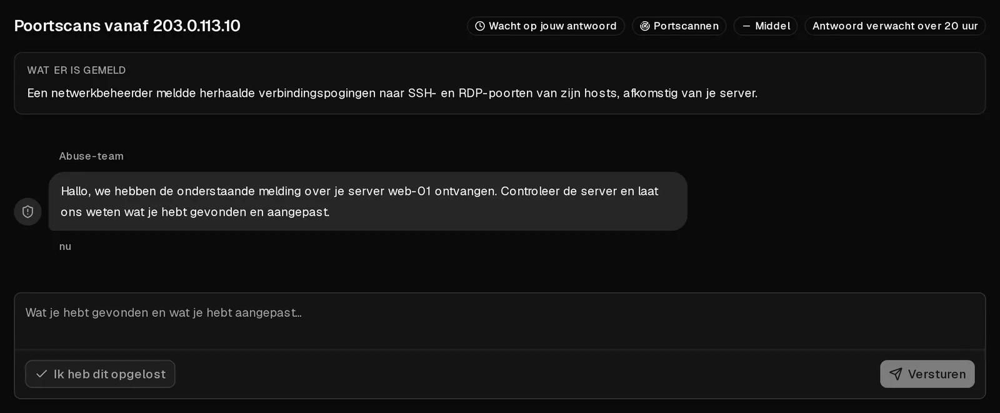

Een misbruikmelding betekent dat iemand ons heeft laten weten dat verkeer van een van je servers schade heeft veroorzaakt: spam, phishing, malware, poortscans, aanvallen op andere systemen of inbreuk op auteursrecht. Heel vaak heeft de eigenaar niets verkeerd gedaan en is de server **gecompromitteerd**, bijvoorbeeld via een zwak wachtwoord of een verouderde applicatie.

Als we een zaak openen, ontvang je een e-mail en vind je de zaak onder [Misbruikmeldingen](https://app.virtbase.com/abuse) in het klantenportaal. **Reageer binnen 24 uur.** Meestal is dat al genoeg om je server gewoon te laten draaien.

## De zaak beantwoorden

1. Open in het [klantenportaal](https://app.virtbase.com/abuse) <Ui>Misbruikmeldingen</Ui> en klik op <Ui>Zaak bekijken</Ui>.
2. Lees <Ui>Wat er is gemeld</Ui>. Daar staan de betrokken server, het soort misbruik en, als dat beschikbaar is, het bewijs.
3. Zoek de oorzaak op je server (zie hieronder) en verhelp die.
4. Beschrijf wat je hebt gevonden en wat je hebt aangepast, en klik op <Ui>Versturen</Ui>. Heb je het al opgelost, klik dan op <Ui>Ik heb dit opgelost</Ui>.

Zodra je reageert, staat de zaak op <Ui>Bij ons team</Ui> en stopt de deadline. We controleren je antwoord en sluiten de zaak, of stellen nog vragen. Je ontvangt een e-mail als de zaak gesloten is.

## De oorzaak vinden

Begin met deze controles, als `root` op de server:

- **Wat het netwerk en de CPU gebruikt:** `top`, en `ss -tunap` voor open verbindingen.
- **Processen die je niet herkent,** vaak in `/tmp`, `/var/tmp` of `/dev/shm`.
- **Geplande taken:** `crontab -l`, `/etc/crontab` en `/etc/cron.*`.
- **Recente logins:** `last` en `/var/log/auth.log` (Debian, Ubuntu) of `/var/log/secure` (AlmaLinux, Rocky Linux).
- **Mailwachtrij, bij spammeldingen:** `mailq`.

Is de server gecompromitteerd, dan is opschonen zelden betrouwbaar. Kopieer je gegevens van de server, [installeer het besturingssysteem opnieuw](/nl/help/article/how-to-change-operating-system), zet je gegevens terug en wijzig elk wachtwoord en elke sleutel die op de server stond.

## Wat er gebeurt als je niet reageert

Bij sommige zaken wordt de betrokken server meteen beperkt. In de andere gevallen geldt: verstrijkt de deadline zonder antwoord, dan wordt de beperking stap voor stap strenger. Het huidige niveau staat in de zaak onder <Ui>Beperkt zolang dit openstaat</Ui>:

| Niveau | Wat het betekent |
| --- | --- |
| <Ui>Onder toezicht</Ui> | Er is niets beperkt. We houden het in de gaten. |
| <Ui>Netwerk beperkt</Ui> | De netwerksnelheid van de server is begrensd. Je kunt nog steeds inloggen en het probleem oplossen. |
| <Ui>Netwerk geblokkeerd</Ui> | Uitgaand verkeer van de server is geblokkeerd. Gebruik de [browserconsole](/nl/help/article/how-to-use-console) om eraan te werken. |
| <Ui>Uitgeschakeld</Ui> | De server is afgesloten en kan niet worden gestart. Je gegevens blijven onaangeroerd. |
| <Ui>Ingepland voor verwijdering</Ui> | Alleen na een besluit van ons team, nooit automatisch. Reageer meteen als je denkt dat dit een vergissing is. |

Uit zichzelf gaan beperkingen nooit verder dan <Ui>Uitgeschakeld</Ui>. Een server verwijderen is altijd een beslissing van een mens.

Zolang een zaak openstaat:

- kun je nog steeds de console gebruiken, wachtwoorden resetten, grafieken bekijken en back-ups maken,
- kun je geen firewallregels wijzigen, de server niet opnieuw installeren, geen back-ups terugzetten en geen <Term id="iso-image">ISO-images</Term> koppelen,
- **staan nieuwe bestellingen, upgrades en handmatige verlengingen in de wacht**. [Automatische verlengingen](/nl/help/article/how-to-set-up-automatic-renewal) lopen gewoon door, dus schakel automatische verlenging in als je termijn afloopt terwijl de zaak openstaat.

Beperkingen worden opgeheven wanneer wij de zaak sluiten, niet wanneer jij reageert. Je eerdere instellingen, inclusief je eigen firewallregels, worden hersteld.

## Als iets niet duidelijk is

- **De melding klopt niet.** Zeg dat in je antwoord en leg uit waarom. We bekijken elk antwoord.
- **De zaak is gesloten, maar er is nog steeds iets mis.** Op gesloten zaken kun je niet meer reageren. [Neem contact op met support](/nl/contact) en vermeld het zaaknummer uit de e-mail.
- **Je hebt meer tijd nodig.** Reageer met wat je tot nu toe hebt gedaan. Een reactie stopt de deadline.
