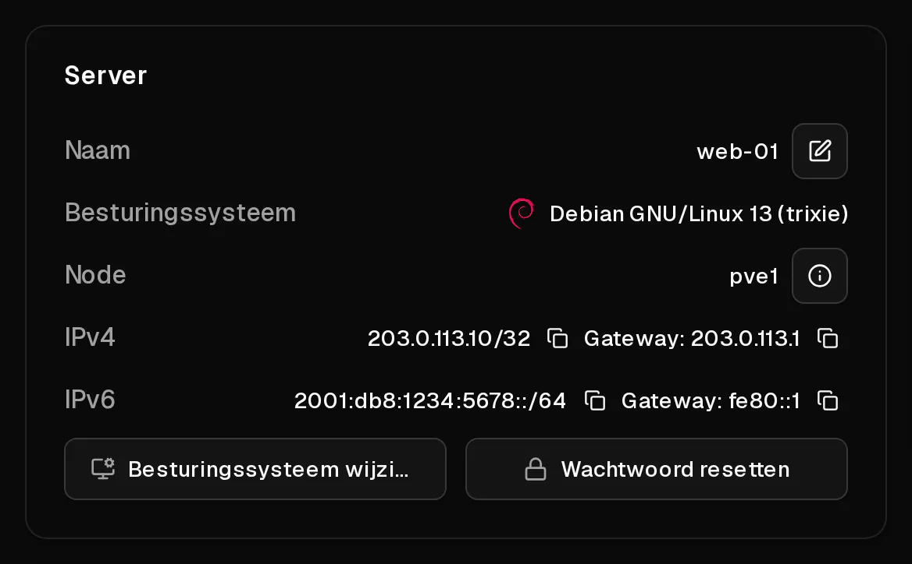

Elke Virtbase-server krijgt:

- **één IPv4-adres**, dat hetzelfde blijft zolang je de server hebt,
- **één IPv6-/64-subnet**, met meer IPv6-adressen dan je ooit nodig zult hebben.

Beide worden automatisch ingesteld op de besturingssystemen die je bij het bestellen kiest. Ze blijven hetzelfde als je de server opnieuw installeert, upgradet of een back-up terugzet.

## Waar vind ik ze?

- In de [serverlijst](https://app.virtbase.com/servers) kopieert <Ui>IP kopiëren</Ui> het <Term id="ipv4">IPv4-adres</Term>.
- Op de pagina <Ui>Overzicht</Ui> van de server tonen de onderdelen <Ui>IPv4</Ui> en <Ui>IPv6</Ui> elk adres met de bijbehorende <Ui>Gateway</Ui>, allebei met een kopieerknop.



## IPv6 gebruiken

Je server heeft een volledig <Term id="ipv6-subnet">/64-subnet</Term>, bijvoorbeeld `2001:db8:1234:5678::/64`. Eén adres daaruit is op de server ingesteld. Je kunt in je server meer adressen uit hetzelfde /64 toevoegen, bijvoorbeeld om meerdere websites op aparte adressen te draaien:

```bash
ip -6 addr add 2001:db8:1234:5678::2/64 dev eth0
```

Wil je het adres na een herstart behouden, voeg het dan toe aan je netwerkconfiguratie (netplan, `/etc/network/interfaces` of NetworkManager, afhankelijk van je systeem).

Je kunt voor elk adres in je /64 [reverse DNS](/nl/help/article/how-to-set-reverse-dns) instellen.

## Kan ik meer IPv4-adressen krijgen?

Extra IPv4-adressen zijn op dit moment niet beschikbaar. Elke server heeft er precies één. Alleen de adressen die aan je server zijn toegewezen, kunnen worden gebruikt: verkeer vanaf elk ander adres wordt geblokkeerd, om het netwerk tegen spoofing te beschermen.

## Netwerksnelheid en dataverkeer

- **Dataverkeer is onbeperkt** onder een <Term id="fair-use">fair-usebeleid</Term>. Gebruikt een server langdurig buitensporig veel, dan kan de snelheid tijdelijk worden beperkt.
- De **uplink wordt gedeeld**: de maximale bandbreedte van een host wordt verdeeld over de servers die erop draaien. Klik op de pagina <Ui>Overzicht</Ui> op <Ui>Nodedetails bekijken</Ui> om de <Term id="uplink">uplink</Term> te zien van de node waarop je server draait.
- Uitgaande poort 25 is open, dus je kunt rechtstreeks vanaf je server [e-mail versturen](/nl/help/article/how-to-set-reverse-dns#e-mail-versturen-vanaf-je-server).

## Het netwerk zelf configureren

Er is geen DHCP: adressen worden statisch ingesteld. Installeer je een systeem vanaf je eigen ISO, of is je netwerkconfiguratie kapot, stel het netwerk dan met de hand in met de waarden van de pagina <Ui>Overzicht</Ui>. Zie [Hoe installeer ik een besturingssysteem vanaf mijn eigen ISO?](/nl/help/article/how-to-install-from-iso#3-installeren-en-het-netwerk-configureren) voor de exacte instellingen.
