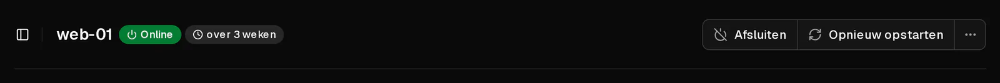
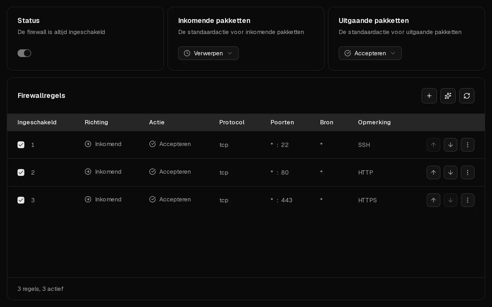

Kun je je server niet bereiken via <Term id="ssh">SSH</Term> of <Term id="rdp">RDP</Term>, dan ligt de oorzaak bijna altijd bij een van vier dingen: de server draait niet, een firewall laat je verbinding niet door, de SSH-dienst in de server luistert niet, of je login wordt geweigerd. Loop de controles hieronder op volgorde door. Elke controle kost ongeveer een minuut, en met de browserconsole los je de meeste problemen op, zelfs als het netwerk voor jou dichtzit.

Heb je al een foutmelding, ga dan direct naar [wat je SSH-foutmelding betekent](#wat-je-ssh-foutmelding-betekent).

## 1. Controleer of de server draait

1. Open het [klantenportaal](https://app.virtbase.com/servers) en klik op <Ui>Bekijken</Ui> naast je server.
2. Kijk naar de status op de pagina <Ui>Overzicht</Ui>. Daar hoort <Ui>Online</Ui> te staan.



Wat je doet als dat niet zo is:

- **Offline:** klik op <Ui>Starten</Ui> en wacht ongeveer een minuut tot het besturingssysteem is opgestart.
- **Server wordt geïnstalleerd:** de server wordt ingericht, opnieuw geïnstalleerd of teruggezet vanaf een back-up. Wacht tot de banner verdwijnt.
- **Server opgeschort:** de termijn is verlopen. [Verleng de server](/nl/help/article/how-to-renew-server), dan start hij weer.

Controleer ook of je het juiste adres gebruikt. <Ui>IP kopiëren</Ui> in de [serverlijst](https://app.virtbase.com/servers) kopieert het <Term id="ipv4">IPv4-adres</Term> van de server.

## 2. Open de console

De [browserconsole](/nl/help/article/how-to-use-console) toont het scherm van je server zonder het netwerk te gebruiken. Open het tabblad <Ui>Console</Ui>.

- **Je ziet een loginprompt:** de server werkt. Het probleem zit in het netwerkpad of in de SSH-dienst, dus ga verder met controle 3.
- **Je ziet opstartfouten, een emergency shell of een leeg scherm:** het besturingssysteem is niet goed opgestart. Zie [Mijn server start niet op](#mijn-server-start-niet-op) hieronder.

## 3. Controleer de Virtbase-firewall

De Virtbase-firewall filtert verkeer voordat het je server bereikt. Nieuwe servers laten al het verkeer door, dus de firewall blokkeert je alleen als de instellingen of regels zijn gewijzigd.

1. Open het tabblad <Ui>Firewall</Ui>.
2. Kijk naar <Ui>Inkomende pakketten</Ui>. Staat dat op <Ui>Verwerpen</Ui> of <Ui>Afwijzen</Ui>, dan komt alleen verkeer door dat een regel uitdrukkelijk accepteert.
3. Zorg dat een ingeschakelde regel je verbinding accepteert: richting <Ui>Inkomend</Ui>, actie <Ui>Accepteren</Ui>, protocol <Ui>TCP</Ui>, bestemmingspoort **22** (of de poort die je SSH-server gebruikt; **3389** voor Windows Extern bureaublad).
4. Heeft die regel een <Ui>Bron</Ui>, dan geldt hij alleen voor verkeer vanaf dat adres. Is je eigen IP-adres veranderd, wat bij thuis- en mobiele verbindingen vaak gebeurt, dan geldt de regel niet meer voor jou.

Regels worden van boven naar beneden gecontroleerd, en de eerste regel die overeenkomt, beslist. Een <Ui>Inkomend</Ui>-regel die poort 22 verwerpt en boven je accepteerregel staat, blokkeert je, ook al bestaat die accepteerregel.



Wijzigingen zijn binnen enkele seconden actief. Zie [Hoe gebruik ik de firewall op mijn server?](/nl/help/article/how-to-use-server-firewall) voor hoe regels werken.

## 4. Controleer de firewall in je server

Een firewall in je server, zoals ufw, firewalld of nftables, komt bovenop de Virtbase-firewall: verkeer moet langs allebei. Herkent Virtbase zo'n firewall, dan toont het tabblad Firewall <Ui>Er draait ook een firewall in je server</Ui>.

Log in via de console en sta SSH toe in de firewall van je server:

```bash tab="ufw" tab-group="firewall"
ufw allow 22/tcp
ufw status
```

```bash tab="firewalld" tab-group="firewall"
firewall-cmd --permanent --add-service=ssh
firewall-cmd --reload
```

Tools zoals fail2ban kunnen je IP-adres ook blokkeren na meerdere mislukte inlogpogingen. `fail2ban-client status sshd` toont de geblokkeerde adressen, en `fail2ban-client unban <jouw-ip>` heft de blokkade op.

## 5. Controleer of SSH draait

Controleer in de console of de SSH-dienst draait en op welke poort hij luistert:

```bash tab="Debian / Ubuntu" tab-group="os"
systemctl status ssh
ss -tlnp | grep ssh
```

```bash tab="AlmaLinux / Rocky Linux / Fedora" tab-group="os"
systemctl status sshd
ss -tlnp | grep ssh
```

Is de dienst gestopt, start hem dan met `systemctl start ssh` (of `sshd`). Toont `ss` een andere poort dan 22, maak dan verbinding met die poort: `ssh -p 2222 root@<jouw-ip>`. Vergeet niet die poort in beide firewalls toe te staan.

## Wat je SSH-foutmelding betekent

**`Connection timed out`**
Er antwoordt niets. De server staat uit, het adres klopt niet of een firewall verwerpt de verbinding (controles 1, 3 en 4).

**`Connection refused`**
De server is bereikbaar, maar niets accepteert verbindingen op die poort: SSH draait niet, luistert op een andere poort, of een <Ui>Afwijzen</Ui>-regel weigert de verbinding (controles 3 tot en met 5).

**`Permission denied (publickey)`**
De server accepteert alleen <Term id="ssh-key">SSH-sleutels</Term>, en geen van jouw sleutels is toegestaan. Controleer of je de juiste sleutel gebruikt (`ssh -i ~/.ssh/jouw_sleutel root@<jouw-ip>`). Wil je een sleutel toevoegen, log dan in via de console en voeg hem toe aan `/root/.ssh/authorized_keys`.

**`Permission denied, please try again.`**
Het wachtwoord klopt niet. [Reset het root-wachtwoord](/nl/help/article/how-to-reset-root-password) in het klantenportaal. Wordt ook het nieuwe wachtwoord geweigerd, dan staat de SSH-server mogelijk geen wachtwoordlogins voor root toe: controleer `PasswordAuthentication` en `PermitRootLogin` in `/etc/ssh/sshd_config`.

**`WARNING: REMOTE HOST IDENTIFICATION HAS CHANGED!`**
De server toont een andere hostsleutel dan de sleutel die je computer heeft onthouden. Dat is normaal nadat je [het besturingssysteem hebt gewijzigd](/nl/help/article/how-to-change-operating-system) of een back-up hebt teruggezet. Verwijder de oude sleutel en maak opnieuw verbinding:

```bash
ssh-keygen -R <jouw-ip>
```

Heb je niets opnieuw geïnstalleerd of teruggezet, ga dan niet verder. Neem eerst contact op met support.

## Mijn server start niet op

Toont de console opstartfouten, een beschadigd bestandssysteem of een emergency shell, dan kun je zelf een rescuesysteem starten: upload de ISO van een livesysteem, zoals de installer van Debian of Ubuntu, als [eigen ISO-image](https://app.virtbase.com/account/settings/custom-images), koppel die met <Ui>ISO koppelen</Ui>, en sluit de server daarna af en start hem opnieuw. Vanuit het livesysteem kun je je schijf mounten en repareren.

Een geüploade <Term id="iso-image">ISO-image</Term> is **60 minuten** beschikbaar en wordt daarna automatisch ontkoppeld. Rond de reparatie dus binnen het uur af, of upload de image opnieuw.

Twijfel je, neem dan contact op met support voordat je iets wijzigt.

## Wordt mijn server beperkt vanwege een misbruikmelding?

Staat er een misbruikzaak open voor je server, dan kan het netwerk ervan beperkt of geblokkeerd zijn, of kan de server zijn uitgeschakeld. Je vindt de zaak dan onder [Misbruikmeldingen](https://app.virtbase.com/abuse), en je hebt er een e-mail over ontvangen. Zie [Wat moet ik doen als ik een misbruikmelding krijg?](/nl/help/article/about-abuse-reports)

## Werkt het nog steeds niet?

[Neem contact op met support](/nl/contact) en vermeld:

- je <Ui>Server-ID</Ui> (op het tabblad <Ui>Geavanceerd</Ui>) of je account-ID en de servernaam,
- wat je hebt geprobeerd, en de exacte foutmelding,
- of we op de server mogen inloggen of hem opnieuw mogen opstarten om het probleem te onderzoeken.
