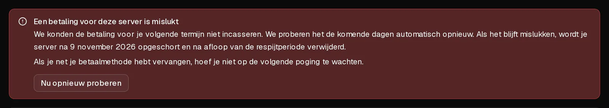

Kan een automatische verlenging niet worden afgeschreven, dan **blijft je server draaien** en wordt er niets verwijderd. We proberen de betaling de week daarna nog een paar keer en sturen je elke keer een e-mail. Je kunt het op elk moment oplossen door een werkende betaalmethode toe te voegen en op <Ui>Nu opnieuw proberen</Ui> te klikken.

Dit artikel gaat over [automatische verlenging](/nl/help/article/how-to-set-up-automatic-renewal). Betaal je elke maand handmatig, zie dan [Hoe verleng ik mijn server?](/nl/help/article/how-to-renew-server)

## Wat er gebeurt, dag voor dag

| Wanneer | Wat er gebeurt |
| --- | --- |
| Einde van de termijn | We schrijven het bedrag af via je betaalmethode. Mislukt dat, dan krijg je de e-mail <Msg>We konden de betaling voor je server niet innen</Msg>. De server blijft draaien. |
| 1, 3, 5 en 7 dagen na het einde van de termijn | We proberen het opnieuw. Vóór de laatste poging krijg je de e-mail <Msg>Je server wordt op [datum] opgeschort</Msg>. |
| Nadat de laatste poging is mislukt | De server wordt opgeschort en uitgeschakeld, en je krijgt de e-mail <Msg>Je server is opgeschort</Msg>. Je gegevens zijn er nog. |
| 5 dagen na de opschorting | De server en al zijn gegevens, inclusief alle back-ups, worden definitief verwijderd. |

Laat je bank ons weten dat een kaart nooit meer kan worden belast, bijvoorbeeld omdat hij is opgezegd, dan stoppen we meteen met opnieuw proberen en staat dat ook in de e-mails. Er gebeurt dan verder niets tot je een andere betaalmethode toevoegt.

## Oplossen

1. Open in het [klantenportaal](https://app.virtbase.com/account/settings/billing) <Ui>Account</Ui> › <Ui>Facturatie</Ui> en klik op <Ui>Kaart toevoegen</Ui>. Voer de nieuwe kaart in en klik op <Ui>Kaart opslaan</Ui>. Bij het toevoegen wordt er niets afgeschreven.
2. Klik naast de nieuwe kaart op <Ui>Gebruiken voor verlengingen</Ui>.
3. Open je server en ga naar het tabblad <Ui>Plan</Ui>. Daar staat de melding <Ui>Een betaling voor deze server is mislukt</Ui>.
4. Klik op <Ui>Nu opnieuw proberen</Ui>.

Het bedrag wordt meteen afgeschreven. Lukt de betaling, dan wordt de server voor een nieuwe termijn verlengd en ontvang je de factuur per e-mail.

Klik je niet op <Ui>Nu opnieuw proberen</Ui>, dan wordt de nieuwe kaart bij de volgende geplande poging gebruikt.

## Controleren of het gelukt is

Op het tabblad <Ui>Plan</Ui> toont het vak van je pakket <Ui>Wordt automatisch verlengd op</Ui>, gevolgd door de volgende datum, en de betaalmelding is verdwenen.

## Als het niet gelukt is

- <Msg>Je bank wil dat je deze betaling bevestigt. Kijk in je bankapp.</Msg> Keur de betaling goed in je bankapp. Klik intussen niet nog een keer op <Ui>Nu opnieuw proberen</Ui>, want dan kan er twee keer worden afgeschreven. We wachten tot 72 uur op de bevestiging.
- <Msg>De betaling is opnieuw geweigerd. We proberen het automatisch nog een keer.</Msg> Gebruik een andere kaart, of vraag je bank waarom de betaling wordt geweigerd. Banken geven ons de reden niet door.
- <Msg>De betaling is geweigerd en er zijn geen pogingen meer over.</Msg> Voeg een werkende betaalmethode toe en [verleng de server](/nl/help/article/how-to-renew-server) daarna op het tabblad <Ui>Plan</Ui>.
- **De server is al opgeschort:** verleng hem op het tabblad <Ui>Plan</Ui>; daarmee wordt hij verlengd en weer gestart. Dat kan tot hij wordt verwijderd, 5 dagen na de opschorting.

Je kunt maximaal drie keer per uur op <Ui>Nu opnieuw proberen</Ui> klikken.

## Waarom werkt een kaart niet meer?

De lijst met kaarten onder <Ui>Account</Ui> › <Ui>Facturatie</Ui> toont de reden:

- **Verlopen — vervang hem om automatische verlenging te behouden:** de vervaldatum van de kaart is verstreken.
- **Gestopt door je bank — vervang hem om automatische verlenging te behouden:** de toestemming om de kaart te belasten is ingetrokken.
- **Geweigerd — vervang hem om automatische verlenging te behouden:** je bank heeft de laatste verlenging geweigerd en ons gevraagd het niet opnieuw te proberen.

Voeg in al deze gevallen een andere kaart toe en kies die met <Ui>Gebruiken voor verlengingen</Ui>.

Twijfel je over een afschrijving, [neem dan contact op met support](/nl/contact), met je account-ID en de servernaam, voordat de server wordt verwijderd.
