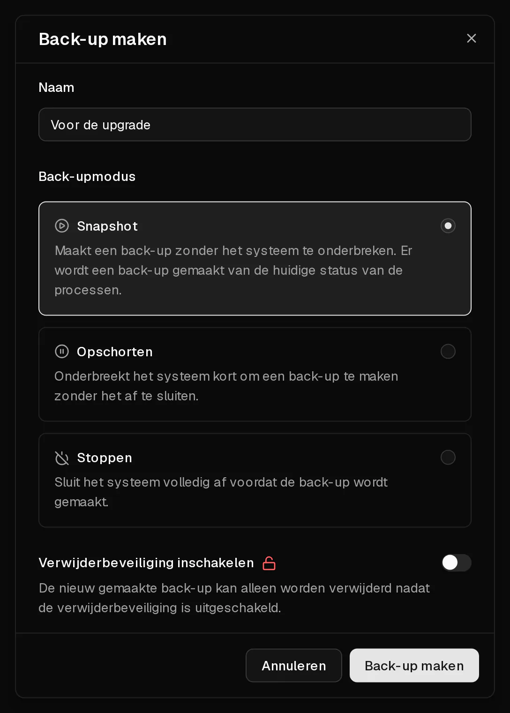

Een back-up is een kopie van de volledige schijf van je server op één moment: het besturingssysteem, je applicaties en je gegevens. Je maakt hem op het tabblad <Ui>Back-ups</Ui>, en je kunt hem later [terugzetten](/nl/help/article/how-to-restore-backup) om de server precies terug te brengen in de staat van dat moment.

Back-ups blijven bewaard tot je ze verwijdert, ook als je het besturingssysteem wijzigt. Ze worden samen met de server verwijderd. Ze beschermen je dus niet als een server wordt verwijderd omdat hij niet is verlengd.

## Een back-up maken

1. Klik in het [klantenportaal](https://app.virtbase.com/servers) op <Ui>Bekijken</Ui> naast je server en open het tabblad <Ui>Back-ups</Ui>.
2. Klik op de knop <Ui>+</Ui> naast <Ui>Back-ups</Ui>.
3. Vul bij <Ui>Naam</Ui> iets in wat je later herkent, bijvoorbeeld `Voor upgrade naar Debian 13`.
4. Kies een <Ui>Back-upmodus</Ui> (zie hieronder). <Ui>Snapshot</Ui> is in de meeste gevallen de juiste keuze.
5. Optioneel: kies <Ui>Verwijderbeveiliging inschakelen</Ui> voor een back-up die je lang wilt bewaren.
6. Klik op <Ui>Back-up maken</Ui>.

De back-up verschijnt in de lijst met de status <Ui>Wordt gemaakt...</Ui>. Als hij klaar is, toont de lijst de grootte. Hoe lang dat duurt, hangt af van hoeveel gegevens er op de schijf staan.

## Welke back-upmodus moet ik kiezen?

| Modus | Wat er gebeurt | Geschikt als |
| --- | --- | --- |
| <Ui>Snapshot</Ui> | De server blijft draaien. Zijn toestand wordt vastgelegd terwijl hij werkt. | Vrijwel altijd. |
| <Ui>Opschorten</Ui> | De server wordt kort gepauzeerd terwijl de back-up wordt gemaakt, en gaat daarna verder. | Applicaties in één keer veel gegevens schrijven, zoals drukke databases, en je een consistente kopie wilt. |
| <Ui>Stoppen</Ui> | De server wordt afgesloten, geback-upt en weer gestart. | Je de schoonst mogelijke kopie wilt en een paar minuten downtime kunt accepteren. |

Bij <Ui>Snapshot</Ui> zorgt de <Term id="guest-agent">QEMU guest agent</Term> in de server ervoor dat schrijfacties die nog openstaan kort naar de schijf worden weggeschreven, zodat de kopie consistent is. De agent is geïnstalleerd op elk besturingssysteem dat je bij het bestellen kiest.

## Een back-up beveiligen tegen verwijderen

Een vergrendelde back-up kan niet worden verwijderd tot je hem ontgrendelt. Zo bescherm je belangrijke back-ups tegen per ongeluk verwijderen, ook door iemand anders die je <Term id="api-key">API-sleutel</Term> gebruikt.

- Om een voltooide back-up te vergrendelen, kies je <Ui>Vergrendelen</Ui> in het menu van de back-up.
- Wil je hem later verwijderen, kies dan eerst <Ui>Ontgrendelen</Ui> en daarna <Ui>Verwijderen</Ui>.

Verwijderingsbeveiliging overleeft de server zelf niet: als een server wordt verwijderd, worden al zijn back-ups mee verwijderd, vergrendeld of niet.

## Limieten

- Je kunt maximaal **5 back-ups per dag** maken, opgeteld over al je servers.
- Per server kan er maar **één back-up tegelijk** lopen.
- Er kunnen geen back-ups worden gemaakt terwijl de server aan het installeren is of is opgeschort.
- Een back-up die na 12 uur nog niet klaar is, wordt gemarkeerd als <Ui>Mislukt</Ui>. Een mislukte back-up bevat niets en kan altijd worden verwijderd.

## Wanneer moet ik een back-up maken?

Maak een back-up vóór alles wat je misschien ongedaan wilt maken:

- voordat je het besturingssysteem wijzigt of naar een nieuwe release upgradet,
- voordat je onbekende software installeert of grotere configuratiewijzigingen doorvoert,
- regelmatig, als de gegevens op de server belangrijk voor je zijn.

Houd er rekening mee dat back-ups bij Virtbase worden opgeslagen. Bewaar van gegevens die je echt niet kwijt mag raken ook een kopie buiten Virtbase, bijvoorbeeld met `rsync` of een back-uptool zoals restic of Borg.

## Kan ik een back-up downloaden?

Niet vanuit het klantenportaal. Heb je een back-up als bestand nodig, [neem dan contact op met support](/nl/contact) en vermeld je <Ui>Server-ID</Ui> van het tabblad <Ui>Geavanceerd</Ui> en de naam van de back-up.

## Als het niet gelukt is

- <Msg>De back-up kon niet worden gemaakt.</Msg> Er loopt nog een andere back-up van deze server, je hebt de limiet van 5 back-ups per dag bereikt, of de server is aan het installeren of opgeschort. Wacht tot de lopende back-up klaar is, of probeer het morgen opnieuw.
- <Msg>De back-up kon niet worden verwijderd.</Msg> De back-up is vergrendeld. Kies eerst <Ui>Ontgrendelen</Ui>.
- **De back-up staat op Mislukt:** verwijder hem en maak een nieuwe. Mislukt die ook, [neem dan contact op met support](/nl/contact).
