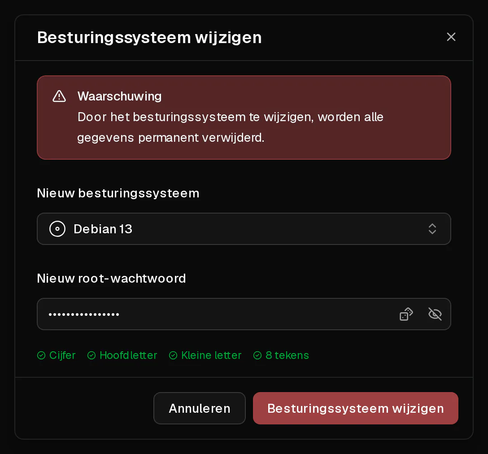

Je kunt je server in een paar klikken opnieuw installeren met elk besturingssysteem uit onze lijst. De herinstallatie **wist alles op de schijf** en richt de server helemaal opnieuw in, alsof je hem net hebt besteld.

Wat hetzelfde blijft: de IP-adressen van de server, het pakket en de termijn, de firewallregels, de <Term id="ptr-record">reverse-DNS-records</Term> en de back-ups.

## Voordat je begint

- Maak een [back-up](/nl/help/article/how-to-backup-server) als er iets op de server staat wat je misschien nog nodig hebt. Back-ups blijven na de herinstallatie bewaard, dus je kunt altijd terug.
- Bedenk een nieuw root-wachtwoord: 8 tot 64 tekens, met minstens één hoofdletter, één kleine letter en één cijfer. Virtbase slaat het niet op.

## Het besturingssysteem wijzigen

1. Klik in het [klantenportaal](https://app.virtbase.com/servers) op <Ui>Bekijken</Ui> naast je server.
2. Klik op de pagina <Ui>Overzicht</Ui> in het vak <Ui>Server</Ui> op <Ui>Besturingssysteem wijzigen</Ui>.
3. Kies bij <Ui>Nieuw besturingssysteem</Ui> het systeem dat je wilt installeren.
4. Vul bij <Ui>Nieuw root-wachtwoord</Ui> het nieuwe wachtwoord in.
5. Bevestig.



De server toont <Ui>Server wordt geïnstalleerd</Ui> en is offline tot het nieuwe systeem is ingericht. Als de banner verdwijnt, kun je inloggen.

Heb je bij het bestellen van de server een <Term id="ssh-key">SSH-sleutel</Term> toegevoegd, dan wordt die op het nieuwe systeem opnieuw ingesteld.

## Controleren of het gelukt is

Maak verbinding met het nieuwe wachtwoord:

```bash
ssh root@<jouw-ip>
```

<Term id="ssh">SSH</Term> waarschuwt je met `WARNING: REMOTE HOST IDENTIFICATION HAS CHANGED!`. Dat is normaal: het nieuwe systeem heeft nieuwe hostsleutels. Verwijder de oude vermelding en maak opnieuw verbinding:

```bash
ssh-keygen -R <jouw-ip>
```

Het veld <Ui>Besturingssysteem</Ui> op de pagina <Ui>Overzicht</Ui> toont het nieuwe systeem.

## Een systeem installeren dat niet in de lijst staat

Wil je iets installeren wat wij niet aanbieden, bijvoorbeeld Windows, pfSense of een distributie naar keuze, gebruik dan je eigen <Term id="iso-image">ISO-image</Term>. Zie [Hoe installeer ik een besturingssysteem vanaf mijn eigen ISO?](/nl/help/article/how-to-install-from-iso)

## Als het niet gelukt is

- <Msg>Het besturingssysteem kon niet worden gewijzigd.</Msg> De server is opgeschort of nog aan het installeren, of het wachtwoord voldoet niet aan de eisen. Je kunt maximaal twee herinstallaties per minuut starten.
- **Het systeem dat je wilt, staat niet in de lijst:** we bieden alleen systemen aan die beschikbaar zijn op de hardware waarop je server draait. Gebruik [je eigen ISO](/nl/help/article/how-to-install-from-iso), of [neem contact op met support](/nl/contact) om ernaar te vragen.
- **De server staat langer dan 30 minuten op Server wordt geïnstalleerd:** [neem contact op met support](/nl/contact) en vermeld je <Ui>Server-ID</Ui> van het tabblad <Ui>Geavanceerd</Ui>.
