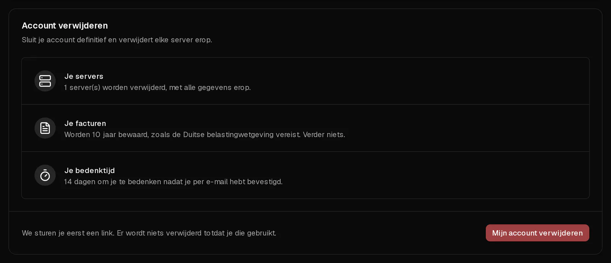

Je kunt je Virtbase-account zelf sluiten in het klantenportaal. Als je het verwijdert, **worden alle servers op het account vernietigd, met al hun gegevens en back-ups**. Om je tegen vergissingen te beschermen, wordt er niets verwijderd tot je per e-mail hebt bevestigd, en daarna heb je nog 14 dagen om je te bedenken.

Wil je alleen stoppen met betalen voor één server, dan hoef je je account niet te verwijderen: [zeg in plaats daarvan het abonnement van die server op](/nl/help/article/how-to-set-up-automatic-renewal#abonnement-opzeggen).

## Voordat je begint

- **Kopieer alles wat je wilt bewaren** van je servers. Back-ups worden samen met de servers verwijderd.
- **Betaal openstaande facturen.** Een account met onbetaalde facturen kan niet worden verwijderd.
- Optioneel: [download eerst een kopie van je gegevens](/nl/help/article/how-to-export-data).

## Je account verwijderen

1. Open in het [klantenportaal](https://app.virtbase.com/account/settings/privacy) <Ui>Account</Ui> › <Ui>Privacy</Ui>.
2. Controleer onder <Ui>Account verwijderen</Ui> de samenvatting: hoeveel servers worden vernietigd en hoe lang je facturen worden bewaard.
3. Klik op <Ui>Mijn account verwijderen</Ui> en typ `DELETE`.
4. Klik op <Ui>Stuur me de link</Ui>.
5. Bevestig onder <Ui>Bevestig dat jij het bent</Ui> met je wachtwoord, een <Term id="passkey">passkey</Term> of een code die je per e-mail ontvangt.
6. Open de e-mail die we je sturen en bevestig via de link. De link is 24 uur geldig.

De pagina Privacy toont nu de datum waarop alles wordt verwijderd.

## Wat er daarna gebeurt

| Wanneer | Wat er gebeurt |
| --- | --- |
| Nadat je per e-mail hebt bevestigd | Je account wordt ingepland voor verwijdering. Je servers blijven draaien. |
| 14 dagen later | Je account, al je servers, hun back-ups en je persoonsgegevens worden definitief verwijderd. |

We bewaren je **facturen 10 jaar**, omdat de Duitse belastingwetgeving dat vereist, en verder niets.

## Je bedenken

Open tot de getoonde datum <Ui>Account</Ui> › <Ui>Privacy</Ui> en klik op <Ui>Mijn account behouden</Ui>. Alles blijft dan zoals het was.

Alleen inloggen stopt de verwijdering niet. Je moet op <Ui>Mijn account behouden</Ui> klikken.

## Als het niet gelukt is

- <Msg>Betaal eerst je openstaande facturen.</Msg> Betaal de onbetaalde facturen onder [Facturen](https://app.virtbase.com/invoices) en probeer het daarna opnieuw.
- <Msg>Er wordt nog een bestelling verwerkt.</Msg> Wacht een paar minuten tot de bestelling klaar is.
- **De e-mail komt niet aan:** kijk in je spammap. De link is 24 uur geldig; begin daarna opnieuw.

## Accounts die niemand gebruikt

Heeft een account 6 maanden lang geen servers en niets factureerbaars gehad, dan plannen we ook dat account in voor verwijdering. Je krijgt 30 dagen van tevoren een e-mail en 7 dagen van tevoren een herinnering. Log je in die periode in, dan blijft je account behouden.
