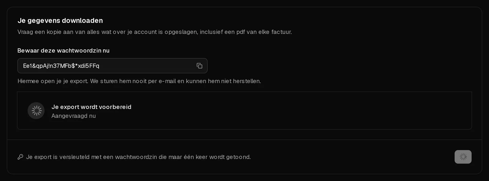

Je kunt op elk moment een kopie downloaden van alles wat Virtbase over je account opslaat: je profiel, servers, bestellingen, betalingen, misbruikzaken en meer, plus een pdf van elke factuur. De export is één pdf-bestand, versleuteld met een wachtwoordzin die alleen jij te zien krijgt.

De export bevat gegevens over je account. De bestanden op je servers zitten er niet in. Wil je die bewaren, kopieer ze dan van de server of maak een [back-up](/nl/help/article/how-to-backup-server).

## Een export aanvragen

1. Open [Account > Privacy](https://app.virtbase.com/account/settings/privacy).
2. Klik onder <Ui>Je gegevens downloaden</Ui> op <Ui>Export aanvragen</Ui>.
3. Bevestig onder <Ui>Bevestig dat jij het bent</Ui> met je wachtwoord, een <Term id="passkey">passkey</Term> of een code die je per e-mail ontvangt.
4. **Bewaar deze wachtwoordzin nu.** Kopieer hem naar je wachtwoordmanager. Je opent er je export mee, en we kunnen hem niet opnieuw tonen of naar je sturen.

Het vak toont <Ui>Je export wordt voorbereid</Ui>. Als de export klaar is, ontvang je de e-mail <Msg>Je gegevensexport is klaar</Msg>.

## Downloaden en openen

1. Open opnieuw <Ui>Account</Ui> › <Ui>Privacy</Ui> en klik onder <Ui>Je export is klaar</Ui> op <Ui>Downloaden</Ui>.
2. Open de pdf in een pdf-lezer en vul de wachtwoordzin in.

De pdf beschrijft je gegevens in leesbare vorm en bevat als bijlagen de volledige gegevens in een JSON-bestand en je facturen. De meeste pdf-lezers tonen bijlagen in een zijpaneel.

De download is **7 dagen** beschikbaar. Daarna staat er <Ui>Je export is verlopen</Ui>, en kun je een nieuwe export aanvragen.

## Limieten

Je kunt één export per dag aanvragen. Probeer je het opnieuw, dan zie je <Msg>Je hebt vandaag al een export aangevraagd. Probeer het morgen opnieuw.</Msg>

## Als het niet gelukt is

- **Je export kon niet worden gemaakt:** vraag de volgende dag een nieuwe aan. Mislukt het opnieuw, [neem dan contact op met support](/nl/contact).
- **Je bent de wachtwoordzin kwijt:** zonder de wachtwoordzin kan de export niet worden geopend. Vraag de volgende dag een nieuwe export aan en bewaar de nieuwe wachtwoordzin.
- **Je wilt je gegevens op een andere manier opvragen,** bijvoorbeeld per e-mail op grond van art. 15 AVG: [neem contact op met support](/nl/contact) vanaf het e-mailadres van je account.
