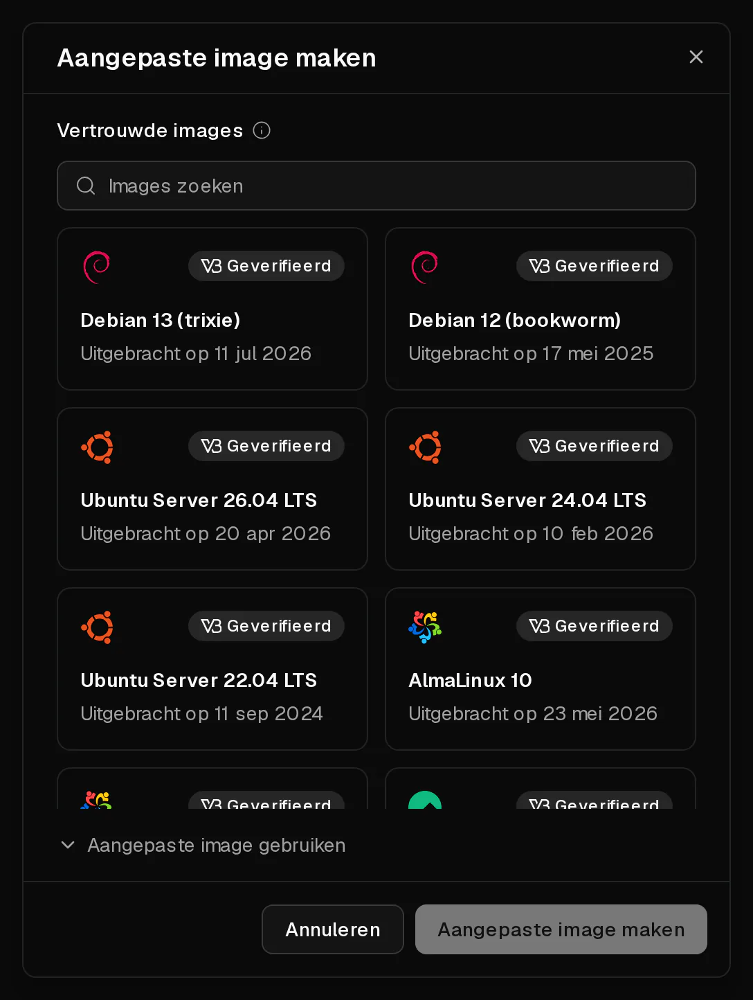
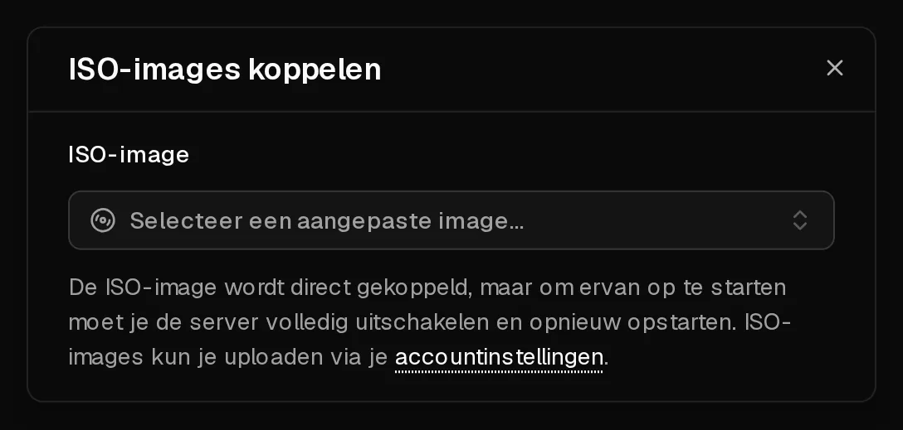

Staat het systeem dat je wilt niet in onze lijst, dan kun je het installeren vanaf een <Term id="iso-image">ISO-image</Term>, net zoals op een fysieke machine: schijf erin, ervan opstarten, installer draaien. Op deze manier kun je ook een livesysteem opstarten om een server te redden die niet meer start.

Installeren vanaf een ISO is bedoeld voor ervaren gebruikers. Anders dan bij onze kant-en-klare systemen wordt er niets voor je ingericht: je configureert het netwerk zelf, en het portaal kan alleen wachtwoorden resetten of het systeem uitlezen als je de <Term id="guest-agent">QEMU guest agent</Term> installeert.

## Voordat je begint

- <Ui>Back-up maken</Ui> van alles wat je wilt bewaren. Bij het installeren van een nieuw systeem wordt de schijf meestal gewist.
- **Noteer je netwerkinstellingen.** Je server heeft statische adressen, en er is geen DHCP. Kopieer op de pagina <Ui>Overzicht</Ui> het <Ui>IPv4</Ui>-adres en de bijbehorende <Ui>Gateway</Ui>, en doe hetzelfde voor <Ui>IPv6</Ui>.
- **Reken op 60 minuten.** Een ISO-image is 60 minuten beschikbaar nadat je hem hebt toegevoegd. Daarna wordt hij automatisch ontkoppeld en verwijderd.

## 1. De ISO-image toevoegen

1. Open [Account > ISO-images](https://app.virtbase.com/account/settings/custom-images) en klik op <Ui>Aangepaste image maken</Ui>.
2. Kies een image uit <Ui>Vertrouwde images</Ui>, zoals Debian, Ubuntu, AlmaLinux, Rocky Linux, Fedora, Alpine, Arch Linux, NixOS, FreeBSD of de VirtIO-drivers voor Windows. Images met het label <Ui>Geverifieerd</Ui> zijn gecontroleerd aan de hand van de checksum van de leverancier.
3. Of kies <Ui>Aangepaste image gebruiken</Ui> en vul een <Ui>Naam</Ui> en de <Ui>URL</Ui> van het ISO-bestand in.
4. Klik op <Ui>Aangepaste image maken</Ui>.



De image wordt naar onze opslag gedownload. De lijst toont de voortgang als <Ui>Uploaden</Ui> met een percentage, en bij <Ui>Verloopt</Ui> het tijdstip waarop de image wordt verwijderd.

Een eigen URL moet:

- beginnen met `https://` en een domeinnaam gebruiken, geen IP-adres,
- rechtstreeks naar een bestand verwijzen dat eindigt op `.iso`, zonder login,
- de bestandsgrootte doorgeven, en die mag maximaal 10 GB zijn.

Je kunt maximaal **3** ISO-images tegelijk hebben, en er maximaal 10 per uur toevoegen.

## 2. Koppelen en ervan opstarten

1. Open je server. Open in de rij met aan/uit-knoppen het menu en kies <Ui>ISO koppelen</Ui>.
2. Kies bij <Ui>ISO-image</Ui> je image. Die wordt meteen gekoppeld.
3. **Sluit de server af en start hem opnieuw.** Opnieuw opstarten vanuit de server is niet genoeg: de server start pas vanaf de ISO op na een volledige stop en start. Gebruik <Ui>Afsluiten</Ui>, wacht tot de server op <Ui>Offline</Ui> staat, en klik dan op <Ui>Starten</Ui>.
4. Open het tabblad <Ui>Console</Ui>. Je ziet de installer of het livesysteem.



## 3. Installeren en het netwerk configureren

Voer de installer uit in de [console](/nl/help/article/how-to-use-console). Vraagt de installer naar het netwerk, kies dan handmatige configuratie en vul in:

| Instelling | Waarde |
| --- | --- |
| <Term id="ipv4">IPv4-adres</Term> | Het adres van de pagina <Ui>Overzicht</Ui>, met prefix `/32` |
| IPv4-<Term id="gateway">gateway</Term> | De <Ui>Gateway</Ui> van de pagina <Ui>Overzicht</Ui> |
| DNS-servers | `9.9.9.9` en `149.112.112.112`, of je eigen servers |
| IPv6-adres | Een adres uit je /64, met prefix `/64` |
| IPv6-gateway | De IPv6-<Ui>Gateway</Ui> van de pagina <Ui>Overzicht</Ui> |

Omdat het adres een `/32` is, ligt de gateway niet in hetzelfde subnet. Veel installers kunnen daarmee omgaan; doet de jouwe dat niet, voeg dan eerst een route naar de gateway toe. Met netplan bijvoorbeeld:

```yaml title="/etc/netplan/01-network.yaml"
network:
  version: 2
  ethernets:
    eth0:
      addresses: [203.0.113.10/32]
      routes:
        - to: 203.0.113.1/32
          scope: link
        - to: 0.0.0.0/0
          via: 203.0.113.1
          on-link: true
      nameservers:
        addresses: [9.9.9.9, 149.112.112.112]
```

## 4. De ISO ontkoppelen

Als de installatie klaar is, open je <Ui>ISO koppelen</Ui> opnieuw en klik je op de ontkoppelknop naast de image. Sluit de server af en start hem opnieuw, zodat hij vanaf zijn schijf opstart.

Installeer daarna de QEMU guest agent, bijvoorbeeld met `apt install qemu-guest-agent`. Zonder de agent kan het portaal geen [wachtwoorden resetten](/nl/help/article/how-to-reset-root-password), geen schijfgebruik tonen en geen firewallaanbevelingen geven.

## Windows installeren

Windows is toegestaan op Virtbase-servers. Wij leveren geen Windows-images of -licenties: je installeert Windows vanaf je eigen ISO en gebruikt je eigen licentie.

1. Zet op het tabblad <Ui>Geavanceerd</Ui> het BIOS op <Ui>UEFI</Ui> en de <Term id="tpm">TPM</Term> op <Ui>v2.0</Ui>. Zonder die instellingen laat Windows 11 zich niet installeren.
2. Voeg je Windows-ISO toe en de <Ui>VirtIO-drivers</Ui> uit <Ui>Vertrouwde images</Ui>.
3. Koppel de Windows-ISO en start de installer zoals hierboven beschreven.
4. Vindt de installer geen schijf, koppel dan in plaats daarvan de ISO met de VirtIO-drivers. Die vervangt de Windows-ISO in het virtuele station. Kies in de installer <Ui>Stuurprogramma laden</Ui> en selecteer het opslagstuurprogramma op de driverschijf.
5. Koppel de Windows-ISO opnieuw en ga verder met de installatie.
6. Installeer na de installatie de overige VirtIO-drivers en de guest agent vanaf de driver-ISO, en stel het netwerk in zoals in de tabel hierboven.

## Een server redden die niet opstart

Wil je een kapot systeem repareren, koppel dan een livesysteem zoals de installer van Debian of Ubuntu, start het op en mount van daaruit je schijf. Ontkoppel de ISO als je klaar bent. Weet je niet zeker wat je moet doen, [neem dan contact op met support](/nl/contact) voordat je iets wijzigt.

## Als het niet gelukt is

- **De ISO-image wordt niet toegevoegd:** controleer of de URL begint met `https://`, eindigt op `.iso` en geen login vereist, en of het bestand niet groter is dan 10 GB.
- <Msg>Je kunt maximaal 3 actieve ISO-images hebben.</Msg> Wacht tot er een verloopt; images worden 60 minuten na het toevoegen verwijderd.
- **De server start het oude systeem op:** je hebt opnieuw opgestart in plaats van afgesloten en gestart. Sluit de server volledig af en start hem daarna.
- **Geen netwerk na de installatie:** controleer de adresprefix (`/32`), de route naar de gateway en de DNS-servers. Zie [Ik kan geen verbinding maken met mijn server](/nl/help/article/cant-connect-to-server).
- <Msg>ISO-image kon niet worden gekoppeld.</Msg> De image wordt nog gedownload of is verlopen, of de server is aan het installeren, opgeschort of beperkt door een misbruikzaak.
