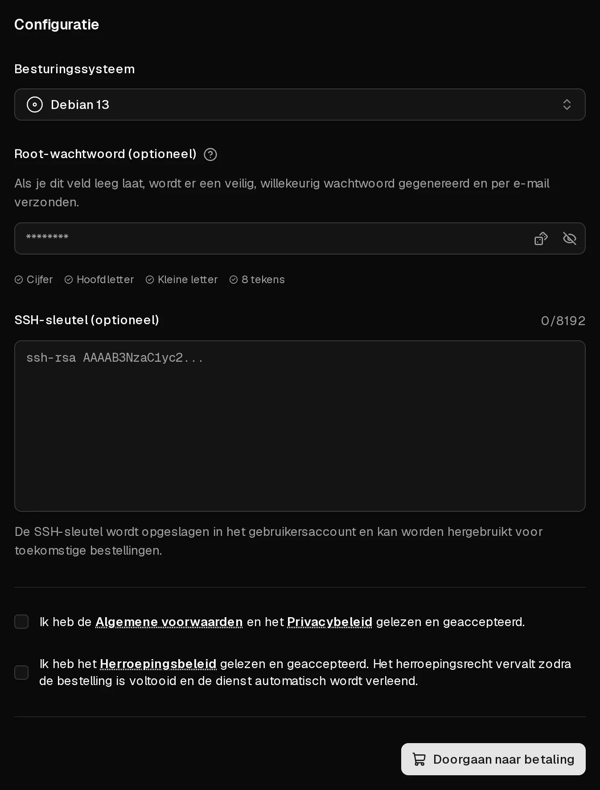

Bestellen duurt een paar minuten: je kiest een pakket en het besturingssysteem, en je betaalt. Virtbase installeert de server daarna automatisch en stuurt je een e-mail zodra je kunt inloggen. Je hebt een Virtbase-account nodig, dat je tijdens het bestellen kunt aanmaken.

Elk pakket bevat één <Term id="ipv4">IPv4-adres</Term>, een <Term id="ipv6-subnet">IPv6-/64-subnet</Term> en onbeperkt dataverkeer onder een <Term id="fair-use">fair-usebeleid</Term>. Prijzen zijn per maand en inclusief de wettelijke btw, waar die van toepassing is.

## De bestelling plaatsen

1. Kies op de [homepage van Virtbase](/nl) een pakket en klik op <Ui>Nu configureren</Ui>. Staat er bij een pakket <Ui>Uitverkocht</Ui>, dan kan het op dit moment niet worden besteld.
2. Log in, of klik op <Ui>Registreren</Ui> om een account aan te maken.
3. Kies bij <Ui>Besturingssysteem</Ui> het systeem dat je wilt installeren.
4. Optioneel: kies bij <Ui>SSH-sleutel (optioneel)</Ui> een bestaande sleutel, of klik op <Ui>Nieuwe SSH-sleutel toevoegen</Ui> en plak je openbare sleutel. Je kunt dan zonder wachtwoord inloggen.
5. Optioneel: stel bij <Ui>Root-wachtwoord (optioneel)</Ui> een wachtwoord in voor `root`. Laat je het leeg, dan wordt er een veilig, willekeurig wachtwoord gegenereerd en per e-mail naar je verstuurd.
6. Ga akkoord met de Servicevoorwaarden, het Privacybeleid en het Herroepingsbeleid.
7. Klik op <Ui>Doorgaan naar betaling</Ui>.

<Hint>
Virtbase slaat je root-wachtwoord niet op. Schrijf het op, of gebruik een <Term id="ssh-key">SSH-sleutel</Term>. Je kunt het wachtwoord op elk moment [resetten](/nl/help/article/how-to-reset-root-password) in het klantenportaal.
</Hint>

## Betalen

1. Vul je <Ui>Factuuradres</Ui> in. Dat wordt gebruikt voor de factuur en om de btw te berekenen.
2. Kies een <Ui>Betaalmethode</Ui>: kaart, <Term id="sepa-mandate">SEPA-incasso</Term> of PayPal. Bij bestellingen vanaf € 5,00 kun je ook kiezen voor <Ui>Betaal anoniem met cryptocurrency</Ui>.
3. Klik op <Ui>Nu betalen</Ui> en rond de bevestiging af als je bank daarom vraagt.

Betalingen met kaart en PayPal worden binnen enkele seconden bevestigd. Bij SEPA-incasso en cryptocurrency zie je <Ui>De betaling wordt verwerkt</Ui>: de bestelling wordt pas uitgevoerd zodra de betaling binnen is, en dat kan langer duren.

Door de bestelling af te ronden, ga je ermee akkoord dat de server direct wordt geleverd. Je herroepingsrecht vervalt daarom zodra de server is ingericht, zoals beschreven in het Herroepingsbeleid.

## Na de betaling

Je server verschijnt in de [serverlijst](https://app.virtbase.com/servers) met de status <Ui>Installeren...</Ui>. De installatie loopt automatisch en duurt meestal een paar minuten.

Als die klaar is, ontvang je de e-mail <Msg>Je server is nu klaar</Msg> met de gebruikersnaam en, als je zelf geen wachtwoord hebt ingesteld, het gegenereerde root-wachtwoord. Om veiligheidsredenen staat het IP-adres niet in de e-mail. Klik in de serverlijst op <Ui>IP kopiëren</Ui> om het te kopiëren.

Volgende stap: [maak voor het eerst verbinding met je server](/nl/help/article/how-to-connect-to-server).

Je server draait één maand. Wil je hem laten doordraaien, [verleng hem dan](/nl/help/article/how-to-renew-server) of [schakel automatische verlenging in](/nl/help/article/how-to-set-up-automatic-renewal). Je factuur wordt opgeslagen onder [Facturen](https://app.virtbase.com/invoices) en per e-mail naar je verstuurd.

## Als er iets misging

### De betaalpagina meldt een probleem

- <Ui>Bestelling vereist actie</Ui> of **Bestelling vereist bevestiging:** je bank wil dat je de betaling bevestigt, bijvoorbeeld in je bankapp. Bevestig de betaling en ga terug naar de pagina.
- **De betaling kon niet worden voltooid:** de betaling is geweigerd. Controleer je gegevens, of probeer een andere betaalmethode.
- **Bestelling geannuleerd:** er is niets afgeschreven. Plaats een nieuwe bestelling.

### Ik heb betaald, maar er is geen server

- Bij SEPA-incasso of cryptocurrency wordt de server pas ingericht zodra de betaling binnen is.
- Kijk in de [serverlijst](https://app.virtbase.com/servers). Een server met de status <Ui>Installeren...</Ui> wordt ingericht; de e-mail volgt zodra dat klaar is.
- Zoek in je spammap naar de e-mail <Msg>Je server is nu klaar</Msg>.

Geldt niets hiervan en is er een uur verstreken, [neem dan contact op met support](/nl/contact) en vermeld je account-ID. Die vind je onder <Ui>Je gebruikers-ID</Ui> in je [accountinstellingen](https://app.virtbase.com/account/settings).

### Nieuwe bestellingen staan in de wacht

Zie je <Msg>Nieuwe bestellingen staan in de wacht zolang er een misbruikzaak openstaat.</Msg>, dan staat er nog een misbruikmelding over een van je servers open. Beantwoord die onder [Misbruikmeldingen](https://app.virtbase.com/abuse); zie [Wat moet ik doen als ik een misbruikmelding krijg?](/nl/help/article/about-abuse-reports)
