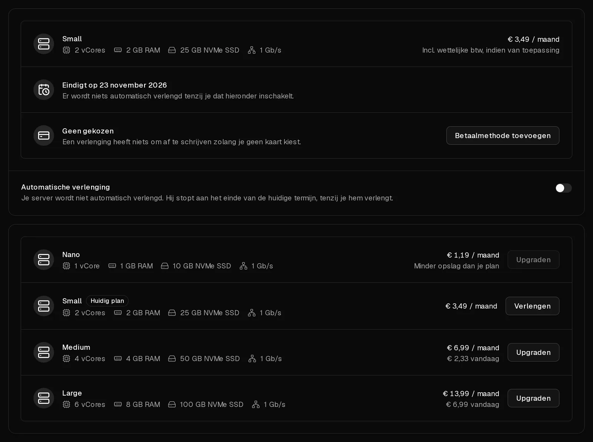

Een Virtbase-server betaal je per maand. Wil je hem laten doordraaien, verleng hem dan voordat de termijn afloopt: handmatig, zoals hier beschreven, of [automatisch](/nl/help/article/how-to-set-up-automatic-renewal), zodat je er nooit meer aan hoeft te denken.

Je kunt op elk moment verlengen. De nieuwe maand komt achter het einde van de huidige termijn, dus vroeg verlengen kost je niets.

## Een server verlengen

1. Klik in het [klantenportaal](https://app.virtbase.com/servers) op <Ui>Verlengen</Ui> naast je server. Daarmee open je het tabblad <Ui>Plan</Ui> van de server.
2. Je huidige pakket is gemarkeerd met <Ui>Huidig plan</Ui>. Klik daar op <Ui>Verlengen</Ui>.
3. Controleer de prijs en klik op <Ui>Verlengen voor</Ui> met het getoonde bedrag.
4. Kies een betaalmethode en klik op <Ui>Nu betalen</Ui>.

Zodra de betaling is verwerkt, wordt de termijn met een maand verlengd. Je ontvangt de e-mail <Msg>Je server is verlengd</Msg> met de nieuwe einddatum, en de factuur staat onder [Facturen](https://app.virtbase.com/invoices).

Wil je in plaats daarvan overstappen op een groter pakket, zie dan [Hoe upgrade ik mijn server naar een groter pakket?](/nl/help/article/how-to-upgrade-server)

## Wat gebeurt er als ik niet verleng?

| Wanneer | Wat er gebeurt |
| --- | --- |
| 5 dagen voor het einde van de termijn | De server toont <Ui>Server verloopt</Ui>, en je krijgt de e-mail <Msg>Je server verloopt binnenkort</Msg>. |
| Einde van de termijn | De server wordt opgeschort en uitgeschakeld, en je krijgt de e-mail <Msg>Je server is opgeschort</Msg>. Je gegevens zijn er nog. |
| 5 dagen na de opschorting | De server en al zijn gegevens, inclusief alle back-ups en de <Term id="ptr-record">reverse-DNS-records</Term>, worden definitief verwijderd. Je krijgt de e-mail <Msg>Je server is verwijderd</Msg>. |

Een verwijderde server kan niet worden hersteld, ook niet door ons supportteam.

## Een opgeschorte server verlengen

Zolang hij niet is verwijderd, kun je een opgeschorte server op dezelfde manier verlengen. Als je hem verlengt, wordt hij weer ingeschakeld, met al zijn gegevens. Zolang hij is opgeschort, kun je hem niet starten, de console niet gebruiken, geen back-ups terugzetten en hem niet opnieuw installeren.

## Als het niet gelukt is

- **Er wacht een bestelling op betaling:** je hebt de betaling gesloten voordat die was verwerkt. Er is niets afgeschreven. Klik op <Ui>Betaling hervatten</Ui>, of op <Ui>Verwijderen</Ui> en begin opnieuw.
- <Msg>Nieuwe bestellingen staan in de wacht zolang er een misbruikzaak openstaat.</Msg> Handmatig verlengen is niet mogelijk zolang er een [misbruikzaak](/nl/help/article/about-abuse-reports) openstaat. Beantwoord de zaak, of schakel automatische verlenging in; die blijft gewoon werken.
- **De betaling wordt geweigerd:** probeer een andere betaalmethode. Bij <Term id="sepa-mandate">SEPA-incasso</Term> wordt de verlenging pas doorgevoerd zodra de betaling binnen is.

Staat de server op het punt verwijderd te worden en kun je niet op tijd betalen, [neem dan contact op met support](/nl/contact) vóór de verwijderdatum.
