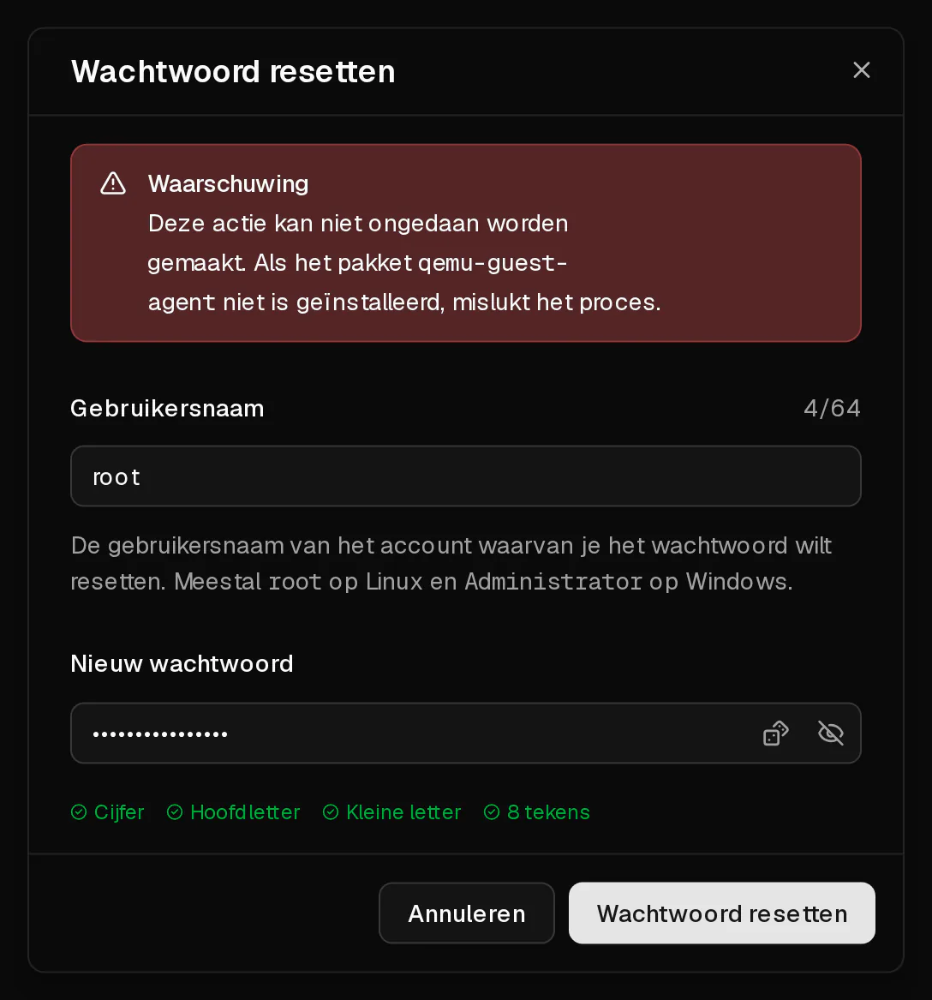

Je kunt in het klantenportaal voor elke gebruiker op je server een nieuw wachtwoord instellen, ook voor `root`. Het nieuwe wachtwoord werkt meteen. De server wordt niet opnieuw opgestart en je gegevens blijven onaangeroerd.

Virtbase slaat je root-wachtwoord niet op, dus we kunnen je het oude wachtwoord niet vertellen. Door het te resetten, kom je weer binnen.

## Voordat je begint

- De server draait: de status op de pagina <Ui>Overzicht</Ui> is <Ui>Online</Ui>.
- De **QEMU guest agent** draait in de server. Die is geïnstalleerd op elk besturingssysteem dat je bij het bestellen kiest. Heb je het systeem zelf vanaf een <Term id="iso-image">ISO-image</Term> geïnstalleerd, [installeer dan eerst de agent](#het-resetten-mislukt).
- Het nieuwe wachtwoord heeft 8 tot 64 tekens, met minstens één hoofdletter, één kleine letter en één cijfer.

## Het wachtwoord resetten

1. Klik in het [klantenportaal](https://app.virtbase.com/servers) op <Ui>Bekijken</Ui> naast je server.
2. Klik op de pagina <Ui>Overzicht</Ui> in het vak <Ui>Server</Ui> op <Ui>Wachtwoord resetten</Ui>.
3. Vul bij <Ui>Gebruikersnaam</Ui> de gebruiker in van wie je het wachtwoord wilt wijzigen. Dat is meestal `root` op Linux en `Administrator` op Windows.
4. Vul bij <Ui>Nieuw wachtwoord</Ui> het nieuwe wachtwoord in.
5. Klik op <Ui>Wachtwoord resetten</Ui>.



Het dialoogvenster sluit en het nieuwe wachtwoord is actief.

## Controleren of het gelukt is

Log in met het nieuwe wachtwoord:

```bash
ssh root@<jouw-ip>
```

Of log in via de [browserconsole](/nl/help/article/how-to-use-console) als <Term id="ssh">SSH</Term> niet bereikbaar is.

## Als het niet gelukt is

### Het resetten mislukt

Het portaal toont <Msg>Het wachtwoord kon niet worden gereset.</Msg> als de server niet draait of de <Term id="guest-agent">guest agent</Term> niet antwoordt.

- Start de server, wacht ongeveer een minuut tot hij is opgestart, en probeer het opnieuw.
- Controleer of de agent draait. Log in via de console, als dat nog lukt, en voer uit:

  ```bash
  systemctl status qemu-guest-agent
  ```

  Ontbreekt de agent, installeer en start hem dan:

  ```bash tab="Debian / Ubuntu" tab-group="os"
  apt install qemu-guest-agent
  systemctl enable --now qemu-guest-agent
  ```

  ```bash tab="AlmaLinux / Rocky Linux / Fedora" tab-group="os"
  dnf install qemu-guest-agent
  systemctl enable --now qemu-guest-agent
  ```

  Op Windows maakt de agent deel uit van het VirtIO-driverpakket (`virtio-win`).

Je kunt een wachtwoord maximaal drie keer per minuut resetten. Zie je <Msg>Je doet dat te vaak. Wacht even.</Msg>, wacht dan een minuut en probeer het opnieuw.

### SSH weigert het nieuwe wachtwoord nog steeds

Het wachtwoord is gewijzigd, maar je SSH-server accepteert geen wachtwoordlogins voor root. Log in via de console en controleer deze twee instellingen in `/etc/ssh/sshd_config`:

```text title="/etc/ssh/sshd_config"
PasswordAuthentication yes
PermitRootLogin yes
```

Start SSH daarna opnieuw met `systemctl restart ssh` (of `sshd`). Een [SSH-sleutel](https://app.virtbase.com/account/settings/ssh-keys) gebruiken in plaats van een wachtwoord is veiliger en voorkomt dit probleem helemaal.

### Je kunt helemaal niet inloggen en de agent is niet geïnstalleerd

Zonder de agent kan het portaal het wachtwoord niet wijzigen. Je kunt dan:

- een rescuesysteem opstarten vanaf een eigen ISO-image en het wachtwoord van daaruit wijzigen (zie [Mijn server start niet op](/nl/help/article/cant-connect-to-server#mijn-server-start-niet-op)), of
- [contact opnemen met support](/nl/contact) met je <Ui>Server-ID</Ui> van het tabblad <Ui>Geavanceerd</Ui>, en laten weten of we de server opnieuw mogen opstarten.

[Het besturingssysteem wijzigen](/nl/help/article/how-to-change-operating-system) geeft je ook een nieuw root-wachtwoord, maar dan wordt alles op de schijf gewist.
