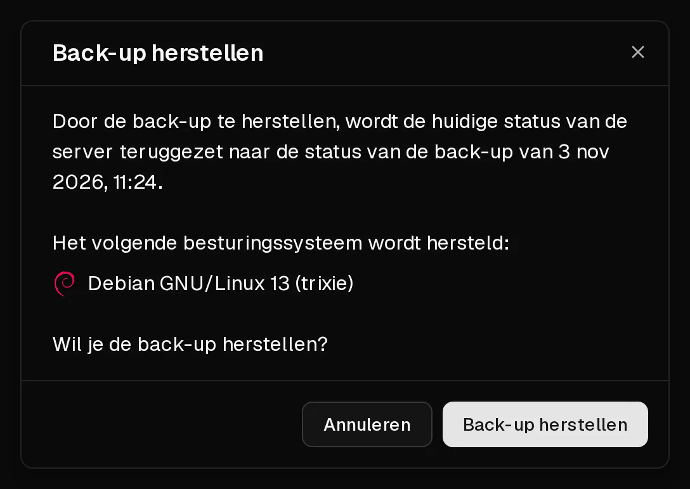

Als je een back-up terugzet, krijgt de schijf van je server weer de staat van het moment waarop de back-up is gemaakt. **Alles wat sindsdien op de server is aangemaakt of gewijzigd, gaat verloren.**

Alleen de schijf wordt vervangen. De server behoudt zijn IP-adressen, firewallregels, <Term id="ptr-record">reverse-DNS-records</Term> en pakket.

## Voordat je begint

- Is er sinds de back-up iets op de server veranderd wat je wilt bewaren, maak dan eerst een [nieuwe back-up](/nl/help/article/how-to-backup-server). Zo kun je zo nodig terug naar de huidige staat.
- De back-up moet klaar zijn. Back-ups met de status <Ui>Wordt gemaakt...</Ui> of <Ui>Mislukt</Ui> kunnen niet worden teruggezet.
- Reken op een korte downtime: de server is offline terwijl de back-up wordt teruggezet.

## De back-up terugzetten

1. Klik in het [klantenportaal](https://app.virtbase.com/servers) op <Ui>Bekijken</Ui> naast je server en open het tabblad <Ui>Back-ups</Ui>.
2. Open het menu van de back-up die je wilt gebruiken en kies <Ui>Herstellen</Ui>.
3. Controleer de datum en het besturingssysteem in het dialoogvenster. Het getoonde besturingssysteem is het systeem dat daarna op de server staat.
4. Bevestig het terugzetten.

De server toont <Ui>Server wordt geïnstalleerd</Ui> terwijl de back-up wordt teruggezet, en start weer op als dat klaar is.

## Controleren of het gelukt is

Is de banner verdwenen, log dan in en controleer of je gegevens in de verwachte staat zijn.

Maak je verbinding via <Term id="ssh">SSH</Term>, dan zie je mogelijk `WARNING: REMOTE HOST IDENTIFICATION HAS CHANGED!` als de back-up van een eerdere installatie is. Dat is normaal. Verwijder de oude sleutel met `ssh-keygen -R <jouw-ip>` en maak opnieuw verbinding.

Het root-wachtwoord is het wachtwoord dat gold toen de back-up werd gemaakt. Weet je dat niet meer, [reset het dan](/nl/help/article/how-to-reset-root-password).

## Limieten

- Je kunt maximaal **5 back-ups per dag** terugzetten, opgeteld over al je servers.
- Terugzetten kan niet starten zolang er een andere back-up of terugzetting van dezelfde server loopt.
- Terugzetten is niet mogelijk zolang de server is opgeschort of door een misbruikzaak wordt beperkt.

## Als het niet gelukt is

- <Msg>De back-up kon niet worden hersteld.</Msg> Er loopt nog een back-up of terugzetting, je hebt de daglimiet bereikt, of de server is opgeschort. Wacht en probeer het opnieuw.
- **De server start niet na het terugzetten:** open de [console](/nl/help/article/how-to-use-console) om te zien wat er tijdens het opstarten gebeurt, en zie [Ik kan geen verbinding maken met mijn server](/nl/help/article/cant-connect-to-server).
- **Het terugzetten lijkt vast te zitten:** staat de server na een uur nog op <Ui>Server wordt geïnstalleerd</Ui>, [neem dan contact op met support](/nl/contact) en vermeld je <Ui>Server-ID</Ui> en de naam van de back-up.
