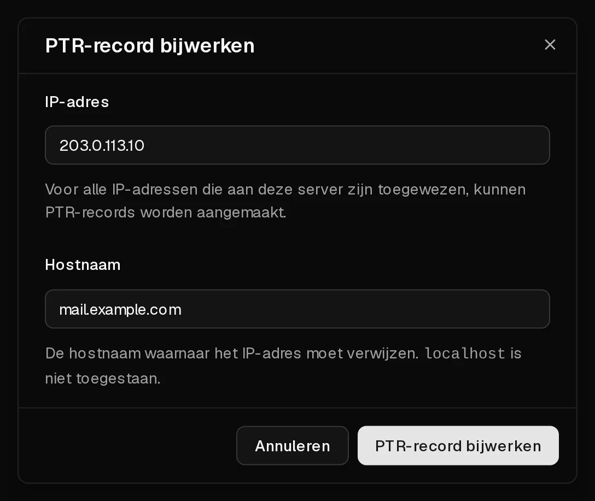

Reverse DNS beantwoordt de vraag "welke hostnaam hoort bij dit IP-adres?". Dat stel je in met een <Term id="ptr-record">PTR-record</Term>. Op het tabblad <Ui>rDNS</Ui> kun je er een instellen voor het <Term id="ipv4">IPv4-adres</Term> van je server en voor elk adres in zijn <Term id="ipv6-subnet">IPv6-/64-subnet</Term>.

De meeste mensen hebben het om één reden nodig: **e-mail versturen**. Veel mailservers weigeren of markeren mail van een adres zonder PTR-record, of van een adres waarvan het PTR-record niet klopt.

## Voordat je begint

Maak eerst bij je domeinprovider een DNS-record aan voor de hostnaam, dat naar de server wijst:

- een **A**-record voor het IPv4-adres, bijvoorbeeld `mail.example.com` → `203.0.113.10`,
- een **AAAA**-record als je ook IPv6 gebruikt.

Het PTR-record en dit record moeten naar elkaar verwijzen. Die overeenkomst, forward-confirmed reverse DNS genoemd, is precies wat ontvangende mailservers controleren.

## Een PTR-record instellen

1. Klik in het [klantenportaal](https://app.virtbase.com/servers) op <Ui>Bekijken</Ui> naast je server en open het tabblad <Ui>rDNS</Ui>.
2. Klik op het potloodpictogram naast <Ui>PTR-records</Ui>.
3. Vul bij <Ui>IP-adres</Ui> het adres in, bijvoorbeeld `203.0.113.10` of `2001:db8::10`.
4. Vul bij <Ui>Hostnaam</Ui> de volledige hostnaam in kleine letters in, bijvoorbeeld `mail.example.com`.
5. Klik op <Ui>PTR-record bijwerken</Ui>.



Het record verschijnt in de tabel. Wil je het wijzigen, herhaal dan de stappen met hetzelfde IP-adres en een nieuwe hostnaam.

## Controleren of het gelukt is

Zoek het adres op vanaf je computer of vanaf de server:

```bash
dig -x 203.0.113.10 +short
```

De uitvoer is je hostnaam, gevolgd door een punt: `mail.example.com.`. Andere DNS-resolvers kunnen het oude antwoord nog een tijdje in hun cache bewaren.

## Een PTR-record verwijderen

Klik op het prullenbakpictogram in de rij van het record en bevestig. Het adres verwijst daarna niet meer naar je hostnaam, en mail die vanaf dat adres wordt verstuurd, kan worden geweigerd.

## E-mail versturen vanaf je server

Uitgaande poort 25 is open op Virtbase-servers, dus je server kan mail rechtstreeks afleveren. Wil je dat mail aankomt en niet in de spam belandt, dan heb je meer nodig dan reverse DNS:

- Een **PTR-record** dat overeenkomt met een **A**- of **AAAA**-record, zoals hierboven.
- **SPF**-, **DKIM**- en **DMARC**-records voor je domein.
- Een mailserver die zich identificeert met dezelfde hostnaam (bij Postfix `myhostname` in `/etc/postfix/main.cf`).

Spam versturen, of mail vanaf een server die gecompromitteerd is, leidt tot [misbruikmeldingen](/nl/help/article/about-abuse-reports) en kan ervoor zorgen dat je adres op een blocklist belandt.

## Als het niet gelukt is

- <Msg>Het PTR-record kon niet worden opgeslagen.</Msg> Controleer of het IP-adres bij deze server hoort en of de hostnaam een geldige, volledig gekwalificeerde naam in kleine letters is. `localhost` is niet toegestaan.
- <Msg>Je doet dat te vaak. Wacht even.</Msg> Je kunt maximaal 10 PTR-records per uur opslaan. Wacht en probeer het opnieuw.
- **Het tabblad rDNS kan niet worden gewijzigd:** PTR-records kunnen niet worden gewijzigd zolang de server is opgeschort. [Verleng de server](/nl/help/article/how-to-renew-server) eerst.

Als een server wordt verwijderd, worden zijn PTR-records mee verwijderd.
