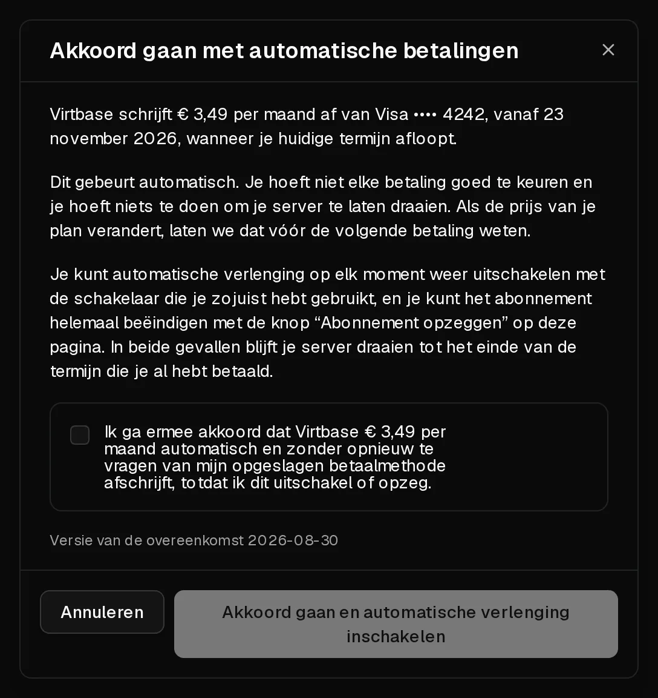

Met automatische verlenging wordt je server aan het einde van elke termijn vanzelf verlengd: we schrijven het bedrag af van je opgeslagen kaart en de server blijft draaien zonder dat je iets hoeft te doen. Zonder automatische verlenging stopt de server aan het einde van de termijn, tenzij je hem [handmatig verlengt](/nl/help/article/how-to-renew-server).

## Voordat je begint

Je hebt een opgeslagen betaalmethode nodig. Wil je er een toevoegen, open dan [Account > Facturatie](https://app.virtbase.com/account/settings/billing), klik op <Ui>Kaart toevoegen</Ui>, voer de kaart in en klik op <Ui>Kaart opslaan</Ui>. Bij het toevoegen wordt er niets afgeschreven.

Betalingen met cryptocurrency kunnen niet worden opgeslagen, dus daarmee is automatische verlenging niet beschikbaar.

## Automatische verlenging inschakelen

1. Klik in het [klantenportaal](https://app.virtbase.com/servers) op <Ui>Bekijken</Ui> naast je server en open het tabblad <Ui>Plan</Ui>.
2. Zet onder <Ui>Automatische verlenging</Ui> de schakelaar aan.
3. Lees de overeenkomst in het dialoogvenster <Ui>Akkoord gaan met automatische betalingen</Ui>. Daarin staan het bedrag, de kaart en de datum van de eerste afschrijving.
4. Vink het vakje aan en klik op <Ui>Akkoord gaan en automatische verlenging inschakelen</Ui>.

Het vak van je pakket toont nu <Ui>Wordt automatisch verlengd op</Ui>, gevolgd door de datum waarop je huidige termijn eindigt. De eerste afschrijving vindt op die datum plaats, niet vandaag.

Automatische verlenging stel je per server in. Herhaal deze stappen voor elke server die je automatisch wilt verlengen.

## De kaart wijzigen die wordt belast

Verlengingen worden afgeschreven van de kaart die voor verlengingen is gemarkeerd. Wil je die wijzigen, open dan [Account > Facturatie](https://app.virtbase.com/account/settings/billing) en klik naast een andere kaart op <Ui>Gebruiken voor verlengingen</Ui>. Het tabblad <Ui>Plan</Ui> van elke server toont welke kaart wordt gebruikt.

## Automatische verlenging uitschakelen

Zet de schakelaar onder <Ui>Automatische verlenging</Ui> op het tabblad <Ui>Plan</Ui> uit. De server blijft draaien tot het einde van de termijn die je hebt betaald. Daarna stopt hij, tenzij je hem handmatig verlengt.

## Abonnement opzeggen

Als je opzegt, eindigt de server aan het einde van de huidige termijn.

1. Klik op het tabblad <Ui>Plan</Ui> onder <Ui>Opzegging</Ui> op <Ui>Abonnement opzeggen</Ui>.
2. Bevestig met <Ui>Abonnement nu opzeggen</Ui>.

Er wordt vandaag niets uitgeschakeld en er wordt niets meer afgeschreven. De server draait tot de getoonde datum, wordt dan afgesloten en 5 dagen later met al zijn gegevens en back-ups verwijderd. Download vóór die tijd alles wat je wilt bewaren.

Toch van gedachten veranderd? Klik vóór het einde van de termijn op <Ui>Abonnement hervatten</Ui>. Hervatten schakelt automatische verlenging niet opnieuw in, dus zet daarna de schakelaar weer aan.

## Als het niet gelukt is

- <Msg>Voeg eerst een betaalmethode toe. Automatische verlenging heeft een kaart nodig die we kunnen belasten als je termijn afloopt.</Msg> Voeg een kaart toe onder <Ui>Account</Ui> › <Ui>Facturatie</Ui> en probeer het daarna opnieuw.
- <Msg>De betaalmethode die we zouden belasten, kan niet worden gebruikt.</Msg> De kaart is verlopen of geweigerd. Kies een andere kaart met <Ui>Gebruiken voor verlengingen</Ui>.
- <Msg>Hervat dit abonnement voordat je automatische verlenging weer inschakelt.</Msg> Het abonnement is opgezegd. Klik eerst op <Ui>Abonnement hervatten</Ui>.
- <Msg>De betaalde periode is afgelopen.</Msg> Een abonnement kan alleen worden hervat zolang de termijn nog loopt. [Verleng de server dan handmatig](/nl/help/article/how-to-renew-server), zolang hij nog niet is verwijderd.

Mislukt een verlengingsbetaling, zie dan [Mijn verlengingsbetaling is mislukt – wat gebeurt er nu?](/nl/help/article/failed-payment)
