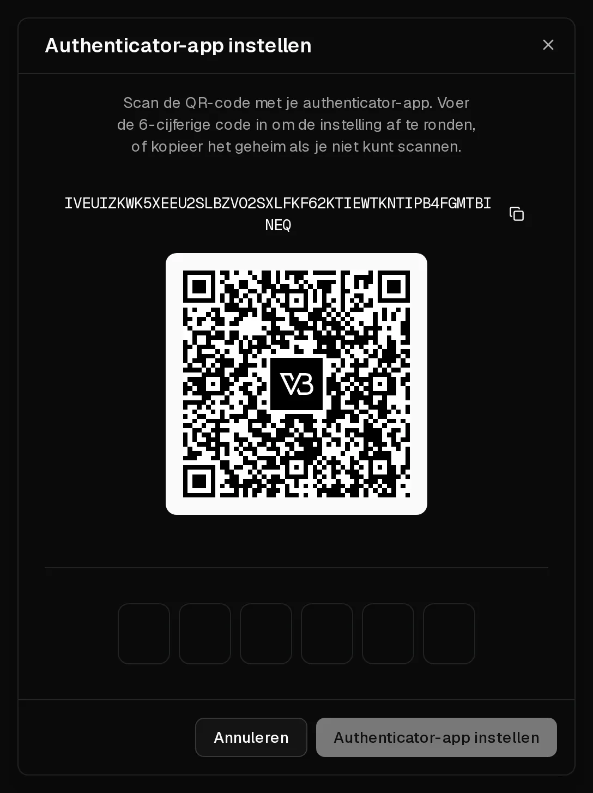

Met je Virtbase-account beheer je je servers, dus het verdient meer bescherming dan alleen een wachtwoord. Op de pagina <Ui>Beveiliging</Ui> van je account kun je:

- bij het inloggen een code uit een **authenticator-app** vereisen (<Term id="two-factor-authentication">tweefactorauthenticatie</Term>),
- inloggen met een **passkey** in plaats van een wachtwoord,
- <Ui>Google</Ui>, <Ui>GitHub</Ui> of <Ui>Discord</Ui> koppelen om mee in te loggen,
- zien waar je bent ingelogd, en andere apparaten afmelden.

## Tweefactorauthenticatie instellen

Je hebt een authenticator-app nodig, zoals 1Password, Google Authenticator of Microsoft Authenticator.

1. Open [Account > Beveiliging](https://app.virtbase.com/account/settings/authentication).
2. Klik onder <Ui>Tweefactorauthenticatie</Ui> naast <Ui>Authenticator-app (TOTP)</Ui> op <Ui>Instellen</Ui>.
3. Bevestig met je wachtwoord.
4. Scan de QR-code met je app. Lukt scannen niet, kopieer dan in plaats daarvan de geheime sleutel naar de app.
5. Vul de 6-cijferige code in die de app toont, en bevestig.

Bij <Ui>Authenticator-app (TOTP)</Ui> staat nu <Ui>Ingesteld</Ui>. Voortaan wordt je na je wachtwoord om de actuele code uit je app gevraagd.

Je <Ui>Herstelcodes</Ui> staan onder <Ui>Tweefactorauthenticatie</Ui>. Bewaar ze in een wachtwoordmanager of print ze. Klik op <Ui>Opnieuw genereren</Ui> om ze door nieuwe codes te vervangen.

Wil je tweefactorauthenticatie naar een nieuwe telefoon verhuizen, klik dan op <Ui>Vervangen</Ui> en scan de nieuwe QR-code met de nieuwe telefoon.

## Een passkey toevoegen

Met een <Term id="passkey">passkey</Term> log je in met je vingerafdruk, je gezicht, de pincode van je apparaat of een beveiligingssleutel. Een passkey kan niet via phishing worden buitgemaakt.

1. Klik op de pagina <Ui>Beveiliging</Ui> onder <Ui>Passkeys</Ui> op <Ui>Passkey toevoegen</Ui>.
2. Volg de aanwijzingen van je browser of apparaat.

Wil je ermee inloggen, kies dan <Ui>Doorgaan met passkey</Ui> op de inlogpagina. Je kunt meerdere passkeys registreren, bijvoorbeeld een op je laptop en een op je telefoon.

## Inloggen met Google, GitHub of Discord

Klik onder <Ui>Authenticatiemethoden</Ui> naast een provider op <Ui>Koppelen</Ui> en bevestig bij die provider. Daarna kun je ermee inloggen. Als je Discord koppelt, kun je ook de [Discord-bot](/nl/help/article/discord-integration) gebruiken. Klik op <Ui>Ontkoppelen</Ui> om een provider te verwijderen.

## Andere apparaten afmelden

<Ui>Actieve sessies</Ui> toont elk apparaat dat op je account is ingelogd, met het IP-adres en het tijdstip waarop het is ingelogd. Klik op <Ui>Uitloggen</Ui> naast elke sessie die je niet herkent.

Sessies eindigen vanzelf 3 dagen na de laatste keer inloggen. Als je je wachtwoord reset via <Ui>Wachtwoord vergeten?</Ui>, worden alle sessies afgemeld.

Zie je een sessie die je niet herkent, meld die dan af, [wijzig je wachtwoord](/nl/help/article/how-to-change-account-settings) en controleer je [API-sleutels](/nl/help/article/how-to-use-public-api).

## Als het niet gelukt is

- <Msg>Ongeldige code. Probeer het opnieuw.</Msg> Zorg dat de tijd op je telefoon automatisch wordt ingesteld: authenticatorcodes hangen af van de juiste tijd. Vul de code in die nu wordt getoond, niet een code die op het punt staat te verlopen.
- **Je bent de telefoon met je authenticator-app kwijt:** log in met een passkey als je die hebt geregistreerd, en klik daarna op <Ui>Vervangen</Ui> om de app op je nieuwe telefoon in te stellen. Heb je geen passkey, [neem dan contact op met support](/nl/contact) vanaf het e-mailadres van je account.
- **De passkey-prompt verschijnt niet:** je browser of apparaat ondersteunt mogelijk geen passkeys. Gebruik een actuele browser, of een ander apparaat.
