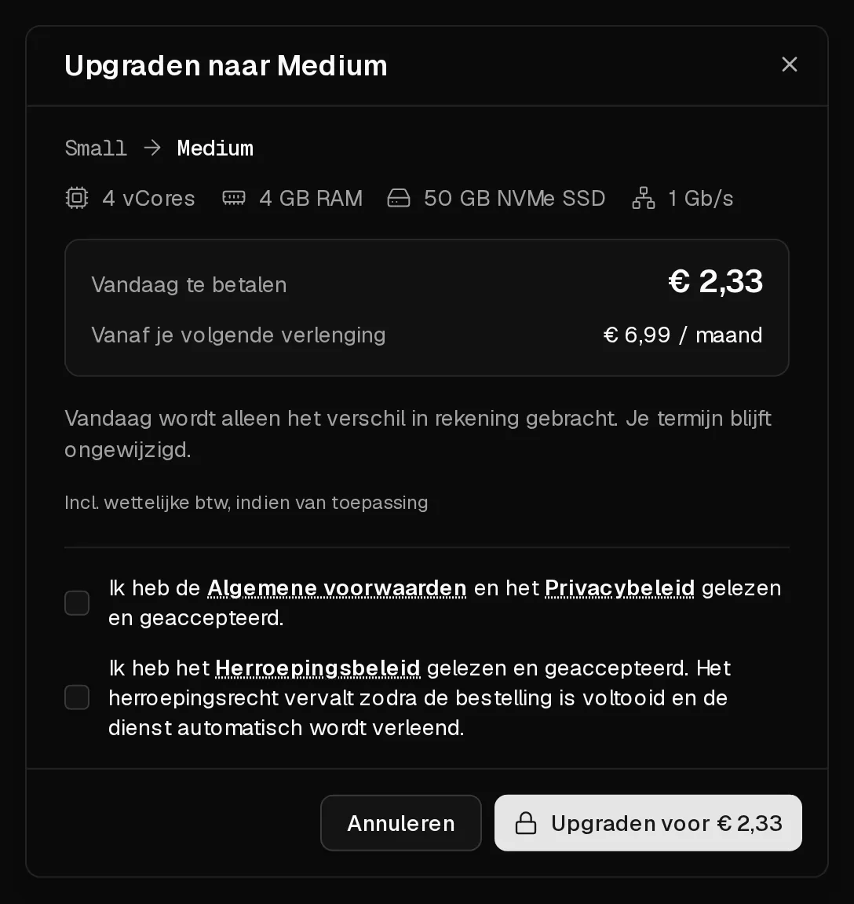

Je kunt je server op elk moment naar een groter pakket verplaatsen via het tabblad <Ui>Plan</Ui>. Je gegevens, IP-adressen en instellingen blijven zoals ze zijn. De server start één keer opnieuw op om de nieuwe resources in gebruik te nemen.

## Wat het kost

Je betaalt alleen het **verschil** tussen de twee pakketten voor de tijd die nog over is in je huidige termijn. Je termijn verandert niet. Vanaf je volgende verlenging betaal je de prijs van het nieuwe pakket.

**Voorbeeld:** je pakket kost € 6 per maand en het nieuwe € 10. Zijn er nog 15 dagen over van je termijn van 30 dagen, dan kost de upgrade vandaag (€ 10 − € 6) × 15 ÷ 30 = **€ 2**. Het minimumbedrag is € 0,50.

Het dialoogvenster toont vóór de betaling het exacte bedrag bij <Ui>Vandaag te betalen</Ui> en de toekomstige prijs bij <Ui>Verlengt tegen</Ui>.

## Voordat je begint

- **Sluit de server netjes af** met <Ui>Afsluiten</Ui> in het portaal of met `poweroff` in de server. De upgrade schakelt de server uit zonder op applicaties te wachten, waardoor anders niet-opgeslagen gegevens verloren kunnen gaan.
- Optioneel: maak een [back-up](/nl/help/article/how-to-backup-server).

## Upgraden

1. Klik in het [klantenportaal](https://app.virtbase.com/servers) op <Ui>Bekijken</Ui> naast je server en open het tabblad <Ui>Plan</Ui>.
2. Kies een groter pakket en klik op <Ui>Upgraden</Ui>.
3. Controleer <Ui>Vandaag te betalen</Ui> en <Ui>Verlengt tegen</Ui>, en klik daarna op <Ui>Upgraden voor</Ui> met het getoonde bedrag.
4. Kies een betaalmethode en klik op <Ui>Nu betalen</Ui>.



Na de betaling wordt de schijf vergroot en wordt de server gestart met de nieuwe resources, ook als je hem vooraf hebt afgesloten. Dat duurt een paar minuten.

## Controleren of het gelukt is

De pagina <Ui>Overzicht</Ui> toont het nieuwe aantal <Term id="vcore">vCores</Term> en het nieuwe geheugen. Controleer in de server:

```bash
nproc       # aantal CPU-cores
free -h     # geheugen
df -h /     # vrije schijfruimte
```

Op onze kant-en-klare besturingssystemen groeien de partitie en het bestandssysteem bij het opstarten automatisch mee. Toont `df -h /` nog de oude grootte, bijvoorbeeld op een systeem dat je vanaf een ISO hebt geïnstalleerd, vergroot ze dan met de hand:

```bash tab="ext4" tab-group="filesystem"
growpart /dev/sda 1
resize2fs /dev/sda1
```

```bash tab="XFS" tab-group="filesystem"
growpart /dev/sda 1
xfs_growfs /
```

Het partitienummer en het bestandssysteem kunnen op jouw systeem anders zijn. `lsblk -f` toont ze.

## Kan ik downgraden?

Nee. Je kunt alleen overstappen op een pakket dat meer kost en minstens evenveel opslag heeft, omdat een schijf niet veilig kan worden verkleind. Wil je naar een kleiner pakket, bestel dan een nieuwe server, verhuis je gegevens en [zeg de oude server op](/nl/help/article/how-to-set-up-automatic-renewal#abonnement-opzeggen).

## Als het niet gelukt is

- **Minder opslag dan je plan:** dat pakket heeft een kleinere schijf dan het jouwe en kan niet worden gekozen.
- **Uitverkocht:** het pakket is op dit moment niet beschikbaar op de hardware van je server. Probeer het later opnieuw.
- <Msg>Je huidige termijn is verlopen. Verleng eerst je server en upgrade daarna.</Msg> [Verleng de server](/nl/help/article/how-to-renew-server) en upgrade daarna.
- **Geen plannen beschikbaar:** er is geen groter pakket op de hardware waarop je server draait.
- <Msg>Nieuwe bestellingen staan in de wacht zolang er een misbruikzaak openstaat.</Msg> Upgrades zijn gepauzeerd tot de [misbruikzaak](/nl/help/article/about-abuse-reports) is gesloten.
- **Er wacht een bestelling op betaling:** klik op <Ui>Betaling hervatten</Ui>, of op <Ui>Verwijderen</Ui> en begin opnieuw.
