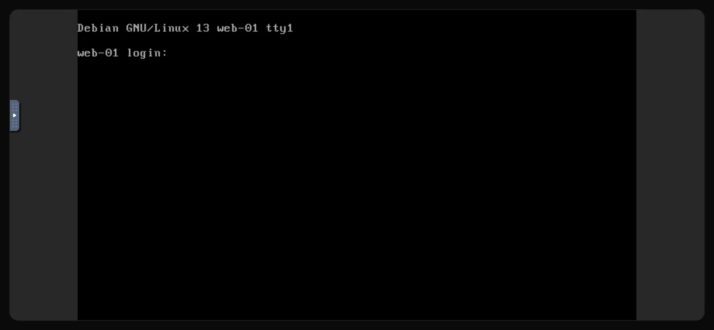

De console is het scherm en het toetsenbord van je server in een browsertabblad. Hij maakt rechtstreeks verbinding met de virtuele machine in plaats van via het netwerk van de server, dus hij werkt ook als <Term id="ssh">SSH</Term> dat niet doet: na een fout in de firewall, bij een kapotte netwerkconfiguratie, of terwijl een besturingssysteem opstart of vanaf een <Term id="iso-image">ISO-image</Term> wordt geïnstalleerd.

## De console openen

1. Klik in het [klantenportaal](https://app.virtbase.com/servers) op <Ui>Bekijken</Ui> naast je server.
2. Open het tabblad <Ui>Console</Ui>.

De console maakt na een paar seconden vanzelf verbinding. Zie je <Ui>Server is niet actief</Ui>, start de server dan; de console maakt verbinding zodra hij draait.

De console is niet beschikbaar terwijl de server aan het installeren is, terwijl hij is opgeschort of terwijl er een back-up wordt gemaakt. Op het tabblad zie je welke van deze situaties van toepassing is.

## Inloggen

Log in met de gebruiker `root` en je root-wachtwoord. Gebruik op Windows het account `Administrator`.

Ken je het wachtwoord niet, [reset het dan](/nl/help/article/how-to-reset-root-password) eerst in het klantenportaal. Een wachtwoord dat je in de console typt, wordt niet op het scherm getoond; dat is normaal.

## Speciale toetsen, volledig scherm en opnieuw verbinden

De console draait op [noVNC](https://novnc.com). De bedieningsbalk zit aan de linkerrand van de console: klik op het kleine lipje om hem te openen.

- <Ui>Extra toetsen</Ui> verstuurt toetscombinaties die je eigen computer anders zelf zou afhandelen, zoals **Ctrl+Alt+Del**, of <Ui>Esc</Ui> en <Ui>Tab</Ui>.
- <Ui>Volledig scherm</Ui> vergroot de console tot het hele scherm.
- <Ui>Verbinding verbreken</Ui> sluit de verbinding. Laad de pagina opnieuw om weer verbinding te maken.

Reageert de console niet meer, laad de pagina dan opnieuw. Zolang het tabblad open blijft, wordt de verbinding automatisch vernieuwd.

## Als het niet gelukt is

### Tekens komen verkeerd door

Typen sommige toetsen andere tekens dan je verwacht, bijvoorbeeld doordat twee letters zijn verwisseld ten opzichte van je toetsenbord, dan wijkt de toetsenbordindeling van je computer af van de indeling die de console verwacht. Typ met de Amerikaanse indeling in gedachten, of stel een tijdelijk wachtwoord in met alleen letters en cijfers die op beide indelingen op dezelfde plek zitten. Wijzig het daarna via SSH.

### Plakken werkt niet

Tekst van je klembord wordt niet in de server getypt, dus plakken werkt niet voor wachtwoorden of opdrachten. Typ ze met de hand, of maak verbinding via [SSH](/nl/help/article/how-to-connect-to-server), waar kopiëren en plakken gewoon werken.

### Het scherm is zwart

De server staat misschien in de slaapstand of toont een zwarte schermbeveiliging. Druk op een toets, of beweeg de muis over de console. Blijft het scherm zwart, controleer dan de status op de pagina <Ui>Overzicht</Ui> en zie [Ik kan geen verbinding maken met mijn server](/nl/help/article/cant-connect-to-server).

## Console vanuit Discord

Gebruik je de [Discord-bot](/nl/help/article/discord-integration), dan kan <Ui>/menu</Ui> een eenmalige consolelink openen. De link is 10 seconden geldig, dus open hem meteen.
