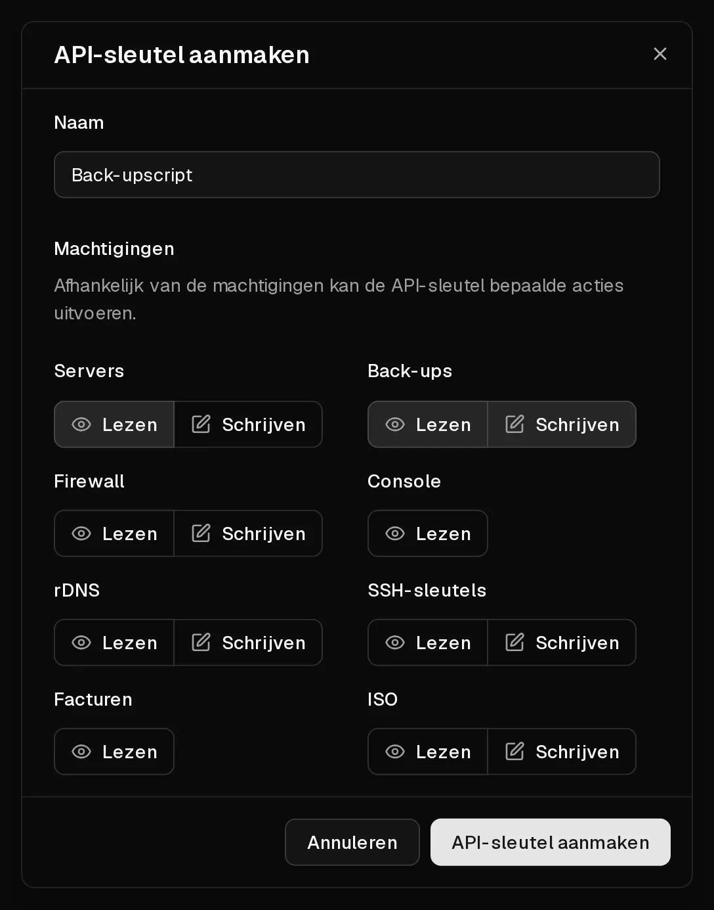

Met de Virtbase-API beheer je je servers vanuit je eigen scripts en tools: aan/uit-acties, back-ups, firewallregels, <Term id="ptr-record">reverse DNS</Term>, <Term id="ssh-key">SSH-sleutels</Term>, <Term id="iso-image">ISO-images</Term> en facturen. Elk verzoek authenticeer je met een <Term id="api-key">API-sleutel</Term>.

De volledige referentie, met elk endpoint en een interactieve client, staat in de [API-documentatie](/api/docs).

## Een API-sleutel aanmaken

1. Open in het [klantenportaal](https://app.virtbase.com/account/settings/api) <Ui>Account</Ui> › <Ui>API</Ui>.
2. Klik op <Ui>API-sleutel aanmaken</Ui>.
3. Vul bij <Ui>Naam</Ui> in waarvoor de sleutel is, bijvoorbeeld `Back-upscript`.
4. Kies bij <Ui>Machtigingen</Ui> <Ui>Lezen</Ui> of <Ui>Schrijven</Ui> voor elk onderdeel dat de sleutel nodig heeft: <Ui>Servers</Ui>, <Ui>Back-ups</Ui>, <Ui>Firewall</Ui>, <Ui>Console</Ui>, <Ui>rDNS</Ui>, <Ui>SSH-sleutels</Ui>, <Ui>Facturen</Ui> en <Ui>ISO</Ui>. Laat al het andere uit.
5. Klik op <Ui>API-sleutel aanmaken</Ui>.
6. Kopieer de sleutel uit <Ui>API-sleutel aangemaakt</Ui> en bewaar hem op een veilige plek, zoals een wachtwoordmanager.



<Hint>
De sleutel wordt maar één keer getoond en kan niet opnieuw worden weergegeven. Ben je hem kwijt, verwijder hem dan en maak een nieuwe aan.
</Hint>

API-sleutels zijn **één jaar** geldig vanaf de dag waarop je ze aanmaakt. Maak vóór die tijd een nieuwe sleutel aan en vervang de oude in je scripts.

## Een verzoek versturen

Zet de sleutel in de header `X-Virtbase-API-Key` van elk verzoek. Zo vraag je bijvoorbeeld een lijst van je servers op:

```bash
curl https://virtbase.com/api/v1/servers \
  -H "X-Virtbase-API-Key: $VIRTBASE_API_KEY"
```

Lijsten zijn gepagineerd met de queryparameters `page` (begint bij 1) en `per_page` (standaard 10, maximaal 100). Veel lijsten kun je sorteren met `sort`, bijvoorbeeld `sort=name:asc`.

## Limieten

Je kunt maximaal **120 verzoeken per minuut** versturen. Sommige acties hebben strengere eigen limieten, bijvoorbeeld 5 aan/uit-acties per minuut of 5 back-ups per dag.

Elk antwoord vertelt je waar je staat:

- `X-RateLimit-Limit`: het aantal toegestane verzoeken in het tijdvenster,
- `X-RateLimit-Remaining`: het aantal verzoeken dat je nog over hebt,
- `X-RateLimit-Reset`: wanneer het volledige tegoed weer beschikbaar is, als Unix-timestamp.

Overschrijd je een limiet, dan antwoordt de API met `429 Too Many Requests`. Wacht tot het resettijdstip voordat je het opnieuw probeert. Heb je een hogere limiet nodig, [neem dan contact op met support](/nl/contact) en beschrijf wat je bouwt.

## Wat de API niet kan

Voor je veiligheid zijn sommige acties alleen mogelijk in het klantenportaal, terwijl je bent ingelogd:

- servers bestellen, verlengen en upgraden,
- betaalmethoden en abonnementen beheren,
- misbruikmeldingen beantwoorden,
- je gegevens exporteren en je account verwijderen.

## Je sleutels veilig houden

- Geef elk script een eigen sleutel met alleen de rechten die het nodig heeft. Een sleutel die alleen facturen kan lezen, kan geen server verwijderen.
- Zet een sleutel nooit in broncode of in een openbare repository. Gebruik een omgevingsvariabele of een secrets manager.
- Verwijder sleutels die je niet meer gebruikt onder <Ui>Account</Ui> › <Ui>API</Ui>.

Is een sleutel uitgelekt, verwijder hem dan meteen en maak een nieuwe aan.

## Als het niet gelukt is

- **`401 Unauthorized`:** de sleutel ontbreekt, is verkeerd getypt, is verwijderd of is verlopen.
- **`403 Forbidden`:** de sleutel heeft niet de machtiging voor deze actie, de actie is alleen in het portaal beschikbaar, of de server is in een toestand die de actie niet toestaat, bijvoorbeeld aan het installeren of opgeschort.
- **`429 Too Many Requests`:** je hebt een limiet bereikt. Zie hierboven.
