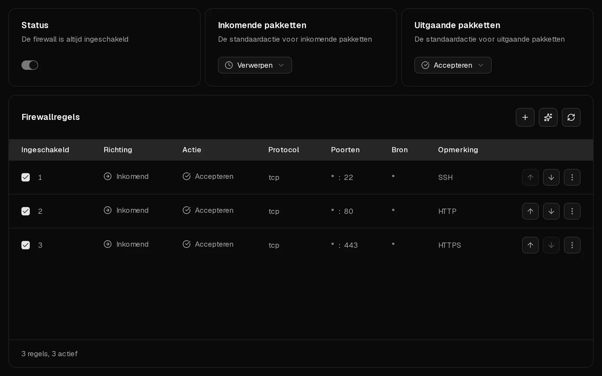
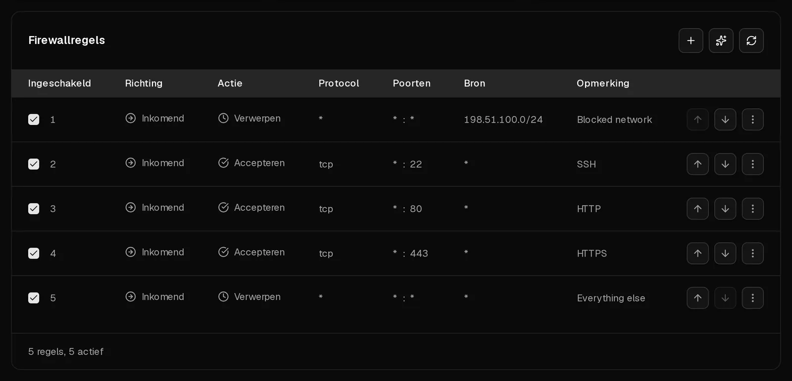

Voor elke Virtbase-server staat een firewall die je beheert op het tabblad <Ui>Firewall</Ui>. Die filtert verkeer voordat het je server bereikt, dus hij beschermt ook een server waarvan de eigen firewall verkeerd is ingesteld.

De firewall staat altijd aan. **Nieuwe servers accepteren al het verkeer in beide richtingen.** Wil je een server beschermen, zet inkomend verkeer dan op <Ui>Verwerpen</Ui> en sta alleen de poorten toe die je echt gebruikt.

## Voordat je begint: sluit jezelf niet buiten

Zet je de standaardactie voor inkomend verkeer op <Ui>Verwerpen</Ui> voordat een regel je <Term id="ssh">SSH</Term>-poort toestaat, dan werkt je SSH-sessie niet meer. Maak dus eerst de regel voor poort 22 aan. Gebeurt het toch, dan werkt de [console](/nl/help/article/how-to-use-console) nog steeds, en je kunt de regels altijd in het portaal herstellen.

## Een nieuwe server beschermen in vier stappen

1. Klik in het [klantenportaal](https://app.virtbase.com/servers) op <Ui>Bekijken</Ui> naast je server en open het tabblad <Ui>Firewall</Ui>.
2. Maak een regel aan die SSH toestaat: klik op <Ui>+</Ui> en zet <Ui>Richting</Ui> op <Ui>Inkomend</Ui>, <Ui>Actie</Ui> op <Ui>Accepteren</Ui>, <Ui>Protocol</Ui> op <Ui>TCP</Ui> en <Ui>Bestemmingspoort</Ui> op `22`. Vul bij <Ui>Opmerking</Ui> bijvoorbeeld `SSH` in en klik op <Ui>Firewallregel aanmaken</Ui>.
3. Voeg zo'n regel toe voor elke andere dienst die bereikbaar moet zijn, bijvoorbeeld `80` en `443` voor een website.
4. Zet <Ui>Inkomende pakketten</Ui> op <Ui>Verwerpen</Ui>.

Wijzigingen zijn binnen enkele seconden actief. Antwoorden op verbindingen die je server zelf heeft geopend, zoals bij het downloaden van pakketten, worden altijd doorgelaten. <Ui>Uitgaande pakketten</Ui> kun je dus op <Ui>Accepteren</Ui> laten staan.

## Een regel aanmaken

Klik boven de lijst met regels op <Ui>+</Ui> en vul in:

| Veld | Wat je invult |
| --- | --- |
| <Ui>Richting</Ui> | <Ui>Inkomend</Ui> voor verkeer naar je server, <Ui>Uitgaand</Ui> voor verkeer dat je server verstuurt. |
| <Ui>Actie</Ui> | <Ui>Accepteren</Ui>, <Ui>Verwerpen</Ui> of <Ui>Afwijzen</Ui> (zie hieronder). |
| <Ui>Protocol</Ui> | Meestal <Ui>TCP</Ui> of <Ui>UDP</Ui>. Kies <Ui>ICMP</Ui> om pings te filteren, en kies daarna een <Ui>ICMP-type</Ui>. |
| <Ui>Bestemmingspoort</Ui> | Eén poort zoals `443`, of een bereik zoals `8000:8100`. |
| <Ui>Bron</Ui> | Optioneel. Een adres of netwerk zoals `198.51.100.7` of `10.0.0.0/8`. Laat het leeg om voor iedereen te gelden. |
| <Ui>Opmerking</Ui> | Optioneel, maximaal 64 tekens. Noteer waarvoor de regel is. |
| <Ui>Ingeschakeld</Ui> | Zet dit uit om een regel te bewaren zonder hem toe te passen. |

Wil je een regel wijzigen, kies dan <Ui>Bewerken</Ui> in het menu ervan. Wil je hem verwijderen, kies dan <Ui>Verwijderen</Ui>.

## Accepteren, Verwerpen of Afwijzen?

- <Ui>Accepteren</Ui> laat het verkeer door.
- <Ui>Verwerpen</Ui> gooit het stilletjes weg. De afzender wacht en krijgt uiteindelijk een time-out.
- <Ui>Afwijzen</Ui> gooit het weg en laat dat de afzender weten, die meteen "connection refused" ziet.

Gebruik <Ui>Verwerpen</Ui> om verkeer van internet te blokkeren: zo verraad je niets over welke diensten er op je server draaien. <Ui>Afwijzen</Ui> is handig binnen je eigen netwerken, waar je wilt dat mislukte verbindingen snel mislukken.

## In welke volgorde worden regels toegepast?

Regels worden **van boven naar beneden** gecontroleerd. De eerste ingeschakelde regel die overeenkomt, bepaalt wat er gebeurt, en de rest wordt genegeerd. Komt geen enkele regel overeen, dan geldt de standaardactie voor die richting: <Ui>Inkomende pakketten</Ui> of <Ui>Uitgaande pakketten</Ui>.

Daarom is de volgorde belangrijk. Een regel die poort 22 voor iedereen verwerpt en boven een regel staat die poort 22 vanaf je kantoor accepteert, blokkeert ook je kantoor. Zet specifieke regels boven algemene, en verplaats regels met <Ui>Omhoog verplaatsen</Ui> en <Ui>Omlaag verplaatsen</Ui> in hun menu.

## Aanbevelingen

Draait de <Term id="guest-agent">QEMU guest agent</Term> in een Linux-server, dan vergelijkt Virtbase de diensten die op je server luisteren met je regels en toont het <Ui>Aanbevelingen</Ui>:

- **Een dienst is bereikbaar vanaf internet:** een database, Redis, de Docker-API of een vergelijkbare dienst staat voor iedereen open. Klik op <Ui>Regel aanmaken</Ui> om die dienst te blokkeren, tenzij je hem bewust wilde publiceren.
- **Een poort wordt in je server geblokkeerd:** je Virtbase-regel staat een poort toe, maar de firewall in je server blokkeert die, waardoor het verkeer nooit aankomt.
- **Er luistert niets op een poort:** een regel opent een poort die geen enkele dienst gebruikt. Klik op <Ui>Regel verwijderen</Ui> om op te ruimen.

SSH, HTTP en HTTPS (poorten 22, 80 en 443) worden nooit gemarkeerd, omdat die bedoeld zijn om openbaar te zijn.

## Een firewall in je server

Draait er op je server een eigen firewall, zoals ufw, firewalld of nftables, dan toont het tabblad <Ui>Er draait ook een firewall in je server</Ui>. Verkeer moet langs **beide** firewalls: een poort moet in allebei openstaan om bereikbaar te zijn. Waar Virtbase de regels in je server kan uitlezen, worden die onder je eigen regels getoond, gemarkeerd met <Ui>Beheerd in je server</Ui>. Die wijzig je in de server, niet in het portaal.

## Laat AI regels voorstellen

Klik op het pictogram met de sterretjes boven de lijst met regels om <Ui>Firewallregels genereren</Ui> te openen. Beschrijf in gewone woorden wat je wilt, bijvoorbeeld "Sta HTTPS toe vanaf overal en SSH alleen vanaf 198.51.100.7", en klik op <Ui>Genereren</Ui>. Je krijgt maximaal 5 voorgestelde regels om te beoordelen. Klik op <Ui>Toepassen</Ui> voor één regel, of op <Ui>Alles toepassen</Ui>. Er verandert niets tot je een regel toepast. Je kunt 10 keer per dag regels genereren.

## Als het niet gelukt is

- **Je hebt jezelf buitengesloten:** open het tabblad <Ui>Firewall</Ui> in het portaal, dat altijd werkt, en voeg een <Ui>Accepteren</Ui>-regel voor je SSH-poort toe boven elke regel die die poort blokkeert, of zet <Ui>Inkomende pakketten</Ui> terug op <Ui>Accepteren</Ui>. Zie [Ik kan geen verbinding maken met mijn server](/nl/help/article/cant-connect-to-server).
- **Een poort is nog steeds onbereikbaar, hoewel een regel hem toestaat:** controleer of er geen regel boven staat die het verkeer verwerpt, of de regel is ingeschakeld, en of de firewall in je server de poort ook toestaat.
- <Msg>De firewallregel kon niet worden aangemaakt.</Msg> Is de server beperkt vanwege een [misbruikzaak](/nl/help/article/about-abuse-reports), dan staan firewallwijzigingen in de wacht tot de zaak is gesloten.
